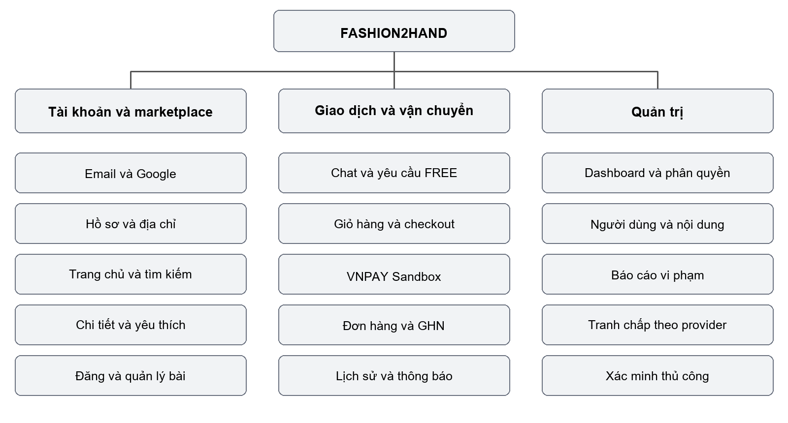
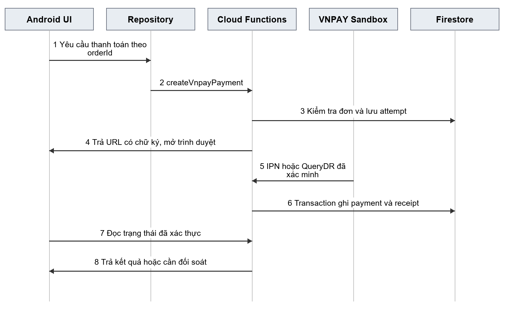

# PHÁT TRIỂN ỨNG DỤNG DI ĐỘNG MUA BÁN VÀ CHO TẶNG QUẦN ÁO ĐÃ QUA SỬ DỤNG FASHION2HAND

BỘ GIÁO DỤC VÀ ĐÀO TẠO

ĐẠI HỌC KINH TẾ THÀNH PHỐ HỒ CHÍ MINH

TRƯỜNG CÔNG NGHỆ VÀ THIẾT KẾ

ĐỒ ÁN MÔN HỌC

Học phần: [Bổ sung tên học phần]

Thành viên: Thư — Minh Anh — Nhi [Bổ sung họ tên đầy đủ và MSSV]

Chuyên ngành, khóa: [Bổ sung]

Giảng viên hướng dẫn: [Bổ sung]

Thành phố Hồ Chí Minh, tháng 10 năm 2026

# MỤC LỤC

[Mục lục tự động được tạo từ các Heading trong bản Word. Cập nhật trường mục lục trước khi nộp.]

# CHƯƠNG 1. TỔNG QUAN

## 1.1. Giới thiệu

Fashion2hand là ứng dụng Android hỗ trợ mua bán và cho tặng quần áo đã qua sử dụng giữa các cá nhân. Người dùng có thể giới thiệu món đồ còn sử dụng được, tìm người mua hoặc người nhận, trao đổi trước giao dịch và theo dõi quá trình xử lý trên cùng một ứng dụng. Mô hình giao dịch thuộc dạng C2C: người sử dụng vừa có thể đăng sản phẩm, vừa có thể mua hoặc xin nhận sản phẩm của người khác.

Ứng dụng phân biệt hai loại bài đăng. Với SALE, người đăng thiết lập giá và người mua thực hiện đặt hàng, thanh toán thử nghiệm. Với FREE, tiền hàng bằng không; người có nhu cầu gửi yêu cầu và người tặng lựa chọn một người nhận. Miễn phí tiền hàng không đồng nghĩa miễn phí vận chuyển. Luồng GHN của món FREE xác định người nhận là bên trả phí giao hàng và không yêu cầu thanh toán VNPAY cho tiền hàng.

Hệ thống có hai nhóm quyền chính là User và Admin. Trong từng giao dịch, User đảm nhiệm vai người bán/người tặng hoặc người mua/người nhận. Admin quản lý người dùng, bài đăng, báo cáo, tranh chấp và hồ sơ xác minh. Việc phân biệt vai trò giúp giới hạn dữ liệu và thao tác theo quan hệ thực tế với bài đăng, hội thoại hoặc đơn hàng.

Mục tiêu của đồ án là xây dựng quy trình từ đăng sản phẩm đến giao nhận có lưu lịch sử, đồng thời xử lý được các tình huống như món đồ đã có người đặt, yêu cầu nhận bị từ chối, thanh toán chưa rõ kết quả và vận chuyển cần kiểm tra. Phiên bản mã nguồn có tích hợp Google để đăng nhập, VNPAY Sandbox để thử nghiệm thanh toán và GHN với sự phân biệt môi trường staging/production. Các thao tác chi trả người bán và hoàn tiền không phải dịch vụ ngân hàng hoàn chỉnh; phạm vi này được giải thích tại Chương 5.

## 1.2. Tính cấp thiết của đề tài

Một món quần áo có thể không còn phù hợp với kích cỡ hoặc nhu cầu của chủ sở hữu nhưng vẫn còn giá trị sử dụng đối với người khác. Khi giao dịch qua nhiều kênh riêng lẻ, thông tin sản phẩm, nội dung trao đổi và tình trạng giao nhận dễ bị tách rời. Người đăng khó kiểm soát ai đang quan tâm, ai được chọn nhận và món đồ còn có thể giao dịch hay không.

Đối với người mua, việc thiếu một quy trình thống nhất gây khó khăn khi xác định tổng chi phí, theo dõi thanh toán hoặc xem lại cam kết giữa hai bên. Đối với người cho tặng, nhiều người cùng xin một món đồ đặt ra yêu cầu lựa chọn duy nhất và thông báo kết quả rõ ràng. Đối với đơn vị vận hành, các báo cáo về nội dung và tranh chấp cần được lưu lại để có căn cứ xử lý.

Fashion2hand giải quyết các vấn đề trên bằng bài đăng có thông tin chuẩn hóa, hội thoại gắn với sản phẩm, yêu cầu nhận đồ có trạng thái và đơn hàng có lịch sử. Hệ thống giữ sản phẩm khi tạo đơn nhằm hạn chế việc cùng một món bị giao cho nhiều người. Phần quản trị tập trung hỗ trợ việc xem xét báo cáo và hồ sơ xác minh. Đây là các nhu cầu nghiệp vụ được sử dụng để xây dựng đồ án; báo cáo không suy diễn thành kết quả khảo sát thị trường hoặc mức tác động môi trường khi chưa có dữ liệu đo lường.

## 1.3. Công cụ phát triển ứng dụng di động

### a) Giới thiệu sơ lược về Java

Java là ngôn ngữ chính của phần Android trong dự án. Các lớp tổ chức giao diện, xử lý sự kiện, biểu diễn dữ liệu và truy cập Firebase được viết bằng Java. Cách tổ chức hướng đối tượng thể hiện qua các lớp như Post, Order, Message, các Repository và các lớp điều khiển màn hình. Cấu hình biên dịch Java của module ứng dụng sử dụng mức tương thích Java 11.

Ứng dụng không áp dụng một kiến trúc duy nhất cho mọi màn hình. MainActivity quản lý nhiều màn hình người dùng; AccountScreens và TransactionScreens tách một phần xử lý theo nhóm chức năng. Chat và Admin sử dụng thêm ViewModel/LiveData. Vì vậy, mô tả dự án là hoàn toàn theo MVVM sẽ chưa phản ánh đúng mã nguồn.

### b) Android SDK

Android SDK cung cấp API và công cụ để biên dịch, cài đặt và chạy ứng dụng. Dự án sử dụng Activity, Fragment, tài nguyên XML, cơ chế nhận kết quả chọn ảnh/chụp ảnh và xử lý vòng đời màn hình. Theo app/build.gradle.kts, compileSdk là 36, minSdk là 29 và targetSdk là 34. minSdk 29 tương ứng mức Android tối thiểu mà cấu hình ứng dụng chấp nhận.

### c) Android Studio

Android Studio là môi trường dùng để quản lý mã Java, tài nguyên XML và tiến trình build Gradle. Layout Editor hỗ trợ xem trước bố cục, trong khi trình gỡ lỗi và Logcat hỗ trợ theo dõi sự kiện và lỗi bất đồng bộ. Android Emulator cho phép kiểm tra nhiều trạng thái giao diện, xoay màn hình và thực hiện kiểm thử tự động trước khi kiểm tra trên thiết bị thật.

### d) Firebase

Firebase Authentication quản lý phiên đăng nhập bằng email/mật khẩu và thông tin xác thực Google. Cloud Firestore lưu hồ sơ, bài đăng, giỏ hàng, yêu cầu nhận đồ, hội thoại và dữ liệu giao dịch. Firebase Storage lưu ảnh sản phẩm, ảnh đại diện và bằng chứng theo từng chính sách truy cập. Cloud Functions là backend tin cậy để kiểm tra quyền, chốt tiền, giữ sản phẩm, tích hợp nhà cung cấp và ghi lịch sử.

Các chức năng quan trọng không chỉ dựa vào việc ẩn nút trên Android. Firestore Rules và kiểm tra ở callable function giới hạn quyền dữ liệu; backend sử dụng transaction cho các thay đổi liên quan nhiều document. Cơ chế này đặc biệt cần thiết khi hai người cùng đặt một món đồ hoặc callback được gửi lặp. [2]

| Công cụ/tích hợp | Vai trò trong Fashion2hand |
|---|---|
| Google qua Credential Manager | Lấy thông tin xác thực để đăng nhập Firebase, sau đó tạo/đọc hồ sơ ứng dụng. |
| VNPAY Sandbox | Tạo phiên thanh toán thử, nhận thông báo và đối soát kết quả từ server. |
| GHN | Tra cứu địa chỉ, báo phí, tạo và tra cứu vận đơn theo môi trường đã cấu hình. |
| GitHub | Lưu mã nguồn, lịch sử thay đổi và minh chứng phát triển nếu có Issue/PR tương ứng. |

## 1.4. Kiểm thử ứng dụng trên Android emulator và trên thiết bị

Môi trường kiểm thử Android đã được ghi nhận trong tài liệu dự án gồm emulator-5554 chạy API 33 và Firebase Emulator cho Authentication, Firestore, Functions, Storage. Ứng dụng có tùy chọn build debug để kết nối các emulator qua máy chủ cấu hình trong BuildConfig. Với Android Emulator, địa chỉ mặc định của máy chủ là 10.0.2.2; bản release không bật chế độ này.

Quy trình kiểm tra gồm build APK, cài ứng dụng, đăng nhập tài khoản thử và chạy lần lượt các nhóm tài khoản, marketplace, chat, giỏ hàng, yêu cầu nhận đồ, đơn hàng và quản trị. Khi xoay màn hình, cần kiểm tra cả khả năng hiển thị lẫn việc giữ nội dung đang nhập. Tải được XML theo hai hướng chưa đủ để chứng minh toàn bộ thao tác thực tế đúng khi bàn phím mở hoặc Activity được tạo lại.

| Thành phần | Cấu hình có căn cứ trong dự án | Phạm vi sử dụng |
|---|---|---|
| Android app | compileSdk 36, minSdk 29, targetSdk 34; Java 11 | Cấu hình build được đọc từ mã nguồn. |
| Android Emulator | emulator-5554, API 33 theo QA_BACKEND_UI_RESULTS.md | Minh chứng lịch sử kiểm thử Android. |
| Firebase Emulator | Auth 9099, Firestore 8080, Storage 9199, Functions 5001 | Thử nghiệp vụ và dữ liệu cô lập. |
| Backend | Node.js 22 theo functions/package.json | Môi trường khai báo cho Cloud Functions. |
| VNPAY | Sandbox | Thanh toán thử nghiệm; không kết luận có thu/chi tiền thật. |
| GHN | Có cơ chế chọn môi trường; tài liệu hiện mô tả staging | Tách biệt thử nghiệm với giao vận production. |
| Thiết bị thật | Chưa có biên bản xác nhận thiết bị/phiên bản trong nội dung đã đối chiếu | Cần bổ sung model, Android và kết quả chạy thực tế. |

# CHƯƠNG 2. PHÂN TÍCH VÀ THIẾT KẾ HỆ THỐNG

## 2.1. Sơ đồ luồng công việc

Phạm vi nghiệp vụ bắt đầu từ xác thực tài khoản và kết thúc ở giao dịch hoàn tất hoặc được xử lý ngoại lệ. User thao tác trên Android; Admin sử dụng khu vực quản trị. Google, VNPAY và GHN là các hệ thống bên ngoài. Trong các luồng dưới đây, mũi tên chỉ thứ tự xử lý; điều kiện trong ngoặc chỉ nhánh cần kiểm tra. Các bước ghi dữ liệu giao dịch do server thực hiện sau khi kiểm tra quyền.

### 2.1.1. Đăng ký và đăng nhập

Luồng đăng ký: nhập email/mật khẩu → kiểm tra biểu mẫu → Firebase Authentication tạo tài khoản → tạo hồ sơ USER/ACTIVE → hướng dẫn xác minh email → vào khu vực phù hợp. Nếu Authentication đã tạo người dùng nhưng hồ sơ chưa lưu được, ứng dụng phải xử lý trạng thái chưa hoàn tất thay vì giả định cả hai bước đã thành công.

Luồng đăng nhập thông thường: nhập thông tin → Authentication kiểm tra → đọc hồ sơ và đồng bộ liên hệ → kiểm tra trạng thái tài khoản → điều hướng. Đăng nhập Google thay bước nhập mật khẩu bằng lựa chọn tài khoản qua Credential Manager, lấy Google ID token và trao đổi thành Firebase credential. Người dùng hủy chọn tài khoản thì luồng dừng, không tạo trạng thái đăng nhập giả. [1]

Quyền Admin cần cả signed custom claim admin và hồ sơ ADMIN đang ACTIVE. Chỉ đọc role từ dữ liệu client là không đủ. Xác minh danh tính thủ công là chức năng riêng; không đồng nhất nó với email_verified. SMS thật đang bị vô hiệu hóa trong AuthRepository; luồng số điện thoại chỉ được cho phép khi chạy đúng chế độ Firebase Emulator.

### 2.1.2. Đăng và quản lý sản phẩm

Luồng chính: nhập thông tin → chọn SALE/FREE → kiểm tra giá và tình trạng → chọn ảnh → tạo bài nháp để xác định quyền sở hữu → upload ảnh → cập nhật đường dẫn và trạng thái cuối → hiển thị kết quả. SALE cần giá lớn hơn không; FREE phải có giá bằng không. Người đăng phải đáp ứng điều kiện tài khoản đã xác minh email hoặc ngoại lệ Admin hợp lệ.

Khi sửa bài, ứng dụng lấy dữ liệu của chủ sở hữu và lưu thay đổi được phép. Bài bị quản trị khóa không thể tự bỏ khóa. Cần phân biệt ẩn/gỡ nội dung với xóa document: Rules hiện chặn xóa trực tiếp posts; hàm deleteListing trong Repository không chứng minh thao tác xóa vật lý hoạt động qua client. Khi trình bày phạm vi hoàn thành, chức năng quản lý bài phải gắn với hành vi được quyền dữ liệu chấp nhận.

### 2.1.3. Tìm kiếm và trao đổi

Luồng khám phá: tải bài ACTIVE → hiển thị danh sách → nhập từ khóa/chọn danh mục → lọc các thẻ đã tải → mở chi tiết → yêu thích hoặc tạo hội thoại. Nguồn danh sách hiện bị giới hạn 50 bài mới nhất; trang chủ sử dụng bốn bài đầu để hiển thị nhanh. Tìm kiếm đang kiểm tra chuỗi con trên dữ liệu phía Android, chưa phải tìm kiếm toàn văn toàn bộ Firestore.

Khi mở hội thoại, backend xác định thành viên và ngữ cảnh bài đăng. Tin nhắn gửi qua callable, còn nội dung được theo dõi qua Firestore listener. Người ngoài hội thoại không được đọc. Cơ chế này giữ trao đổi gắn với món đồ và hỗ trợ xem lại thông tin khi giao dịch phát sinh vấn đề.

### 2.1.4. Cho tặng miễn phí

Luồng GHN: người xin chọn địa chỉ → lấy báo giá → đồng ý phí người nhận trả → gửi yêu cầu PENDING → người tặng xem và chấp nhận một người → transaction tạo đơn FREE, giữ món và cập nhật yêu cầu → thử tạo vận đơn GHN → theo dõi giao nhận → hoàn tất.

Đơn FREE được chấp nhận có paymentStatus=NOT_REQUIRED và orderStatus=READY_TO_SHIP. FREE không đi qua thanh toán VNPAY. Các yêu cầu PENDING khác trong tập được xử lý được chuyển UNAVAILABLE. Mã xử lý giới hạn truy vấn các yêu cầu còn lại ở 450 document; vì vậy không nên diễn giải rằng hệ thống đã kiểm chứng quy mô không giới hạn. Việc transaction kiểm tra bài còn ACTIVE và chưa reserved vẫn là điều kiện ngăn chấp nhận thêm người nhận.

Chấp nhận yêu cầu và gọi API vận chuyển là hai giai đoạn. Nếu GHN lỗi sau khi transaction đã thành công, yêu cầu vẫn ACCEPTED, đơn lưu RETRY_REQUIRED để người tặng xử lý lại. Với staging, mã có nhánh lấy báo giá mới phía server khi chấp nhận và ghi nguồn STAGING_SERVER_QUOTE riêng; nhánh này không được hiểu thành sự đồng ý mới của người nhận cho giao dịch production.

### 2.1.5. Đặt hàng và thanh toán

Luồng mua: chọn sản phẩm SALE → thêm giỏ hoặc mua ngay → chọn địa chỉ → lấy phí GHN → xem tổng tiền → tạo đơn → giữ sản phẩm → tạo phiên VNPAY Sandbox → thanh toán thử → server xác minh → xem đơn đã xác nhận.

Một lượt checkout có thể chọn từ 1 đến 20 món. Backend nhóm theo sellerId; mỗi người bán tạo thành một đơn, có payment và shipment riêng. Giá và địa chỉ được chụp thành snapshot. Báo giá GHN có hạn năm phút; khi nguồn dữ liệu hoặc phí thay đổi, backend yêu cầu lấy lại báo giá. Sau tạo đơn, sản phẩm được giữ 15 phút để thanh toán. idempotencyKey giúp gửi lại cùng thao tác không tạo thêm đơn.

| Trạng thái đơn | Điều kiện sang trạng thái kế tiếp | Bên thực hiện |
|---|---|---|
| PENDING_PAYMENT | Xác minh tiền hợp lệ, đúng số tiền, còn hạn và còn quyền giữ món → CONFIRMED | Backend VNPAY. |
| PENDING_PAYMENT | Hủy hợp lệ hoặc hết hạn → CANCELLED | Backend theo người mua/lịch xử lý. |
| CONFIRMED | Người bán bắt đầu xử lý → PREPARING | Người bán qua backend. |
| PREPARING | Chuẩn bị xong → READY_TO_SHIP | Người bán qua backend. |
| READY_TO_SHIP | Hãng cập nhật trạng thái vận chuyển phù hợp → SHIPPING | Backend GHN. |
| SHIPPING | Hãng xác nhận giao → DELIVERED | Backend GHN. |
| DELIVERED | Người mua xác nhận hoặc đủ hạn kiểm tra và không bị chặn → COMPLETED | Backend xác nhận/lịch xử lý. |

Thanh toán và vận chuyển có trạng thái riêng. PAID không đồng nghĩa DELIVERED; tạo được vận đơn không đồng nghĩa GHN đã lấy hàng. Tiền đến muộn khi đơn đã đóng không tự phục hồi quyền sở hữu sản phẩm mà đi vào đối soát.

### 2.1.6. Vận chuyển GHN

Luồng chính: kiểm tra người bán và điều kiện đơn → xác nhận snapshot GHN, shop và môi trường → tạo mã tham chiếu nội bộ → ghi nhận operation → gọi GHN → đối chiếu kết quả → lưu mã vận đơn → tra cứu/callback → cập nhật trạng thái và lịch sử.

Hệ thống đối chiếu shop với điểm gửi của từng người bán, không sử dụng một địa chỉ kho tùy ý cho mọi tài khoản. Với đơn SALE, trạng thái thanh toán cần PAID và không bị yêu cầu đối soát. Với FREE, tiền hàng không cần thanh toán; GHN thu phí từ người nhận. Payload hiện đặt cod_amount=0. Mã cũng chặn tạo vận đơn SALE production khi chưa có nghiệp vụ thanh toán thật/COD phù hợp.

Nếu API timeout hoặc phản hồi không rõ, operation có thể ở UNKNOWN. Backend tra cứu theo client_order_code trước khi quyết định bước tiếp theo để hạn chế tạo trùng. Callback là tín hiệu để kiểm tra với GHN, không tự biến payload chưa đối chiếu thành bằng chứng giao thành công.

| Nhóm trạng thái vận chuyển | Ý nghĩa xử lý |
|---|---|
| READY/PICKING | Đã tạo hoặc đang chờ lấy hàng; chưa kết luận đã giao. |
| SHIPPING và các trạng thái trung gian | Theo dõi quá trình vận chuyển theo ánh xạ của provider. |
| DELIVERED | Ghi mốc giao, mở thời hạn kiểm tra ba ngày. |
| RETURNING/RETURNED và lỗi cuối | Đánh dấu cần kiểm tra; không tự hoàn tiền chỉ vì hãng báo hoàn. |

### 2.1.7. Hoàn tất và tranh chấp

Luồng hoàn tất: xác minh đơn DELIVERED → kiểm tra bằng chứng giao từ shipment → kiểm tra tranh chấp và thanh toán → người mua xác nhận hoặc hết hạn kiểm tra ba ngày → COMPLETED → ghi nhận xử lý tiền theo provider. Tác vụ định kỳ chạy mỗi 15 phút, nên thời điểm cập nhật có thể sau deadline, không bảo đảm đúng từng giây.

Luồng tranh chấp: người liên quan mở khiếu nại khi đơn đủ điều kiện → gửi lý do và bằng chứng → Admin yêu cầu bổ sung hoặc quyết định → backend ghi lịch sử. Việc mở tranh chấp là trạng thái riêng, có thể tồn tại khi đơn đang SHIPPING hoặc DELIVERED. Không mô tả hệ thống chỉ cho khiếu nại sau giao, vì mã có cả trường hợp đang vận chuyển.

Nhánh quyết định tài chính của Admin hiện chỉ xử lý provider SIMULATED/MOCK cho đơn có tiền; provider VNPAY bị chặn tại bước này. Hoàn tiền VNPAY và chi trả người bán VNPAY được đưa vào REVIEW_REQUIRED ở các nhánh hỗ trợ, chưa tự gọi API ngân hàng. Đây là giới hạn triển khai cần nêu rõ trong đánh giá kết quả.

### 2.1.8. Quản trị hệ thống

Luồng quản trị: đăng nhập → xác minh claim và hồ sơ ACTIVE/ADMIN → tải dashboard hoặc danh sách → mở chi tiết → chọn hành động và nhập lý do → backend kiểm tra lại quyền/trạng thái → cập nhật dữ liệu và nhật ký → thông báo kết quả khi có.

Các nhóm thao tác gồm khóa/mở tài khoản, ẩn/gỡ bài, quản lý danh mục, giám sát giao dịch, xử lý báo cáo, xem tranh chấp và duyệt hồ sơ xác minh thủ công. Khi khóa tài khoản, backend đồng bộ disabled của Authentication và thu hồi refresh token; Rules còn dựa vào accountStatus để giới hạn phiên hiện có. Quyền quản trị không được cấp qua biểu mẫu hồ sơ thông thường.

## 2.2. Sơ đồ phân rã chức năng



Hệ thống được phân rã thành ba nhánh. Nhánh tài khoản và marketplace gồm xác thực, hồ sơ, địa chỉ, trang chủ, tìm kiếm, chi tiết, quản lý bài và yêu thích. Nhánh giao dịch và vận chuyển gồm chat, yêu cầu nhận đồ, giỏ hàng, checkout, VNPAY Sandbox, đơn hàng, GHN, lịch sử và thông báo. Nhánh quản trị gồm dashboard, người dùng, nội dung, giám sát giao dịch, báo cáo, tranh chấp, xác minh và kiểm tra quyền.

| Mã | Chức năng | Tác nhân | Phụ trách theo đề cương |
|---|---|---|---|
| TK01 | Đăng ký, đăng nhập, Google, đăng xuất | User/Admin | Thư |
| TK02 | Hồ sơ và địa chỉ | User | Thư |
| MP01 | Trang chủ, tìm kiếm, chi tiết | Người xem/User | Thư |
| MP02 | Đăng, sửa, ẩn và quản lý bài | Chủ bài | Thư |
| MP03 | Yêu thích | User | Thư |
| GD01 | Hội thoại và tin nhắn | Thành viên hội thoại | Minh Anh |
| GD02 | Gửi/xử lý yêu cầu nhận đồ | Người xin/người tặng | Minh Anh |
| GD03 | Giỏ hàng, báo giá, chia đơn | Người mua | Minh Anh |
| GD04 | VNPAY Sandbox và đối soát | Người mua/backend | Minh Anh |
| GD05 | Đơn hàng, xác nhận và lịch sử | Người mua/người bán | Minh Anh |
| VC01 | Báo phí, vận đơn, theo dõi GHN | User/backend GHN | Minh Anh |
| TB01 | Thông báo và lịch sử giao dịch | User | Minh Anh |
| QT01 | Dashboard, người dùng, nội dung | Admin | Nhi |
| QT02 | Báo cáo, tranh chấp, xác minh | Admin | Nhi |
| QT03 | Kiểm tra quyền và nhật ký thao tác | Backend/Admin | Nhi |
| MR01 | Đánh giá sau giao dịch | Chưa có luồng gửi đánh giá hoàn chỉnh | Phạm vi mở rộng |

Phân công trong bảng là phân công viết/phát triển theo đề cương. Việc xác nhận ai đã thực hiện từng thay đổi cần dựa vào Issue, PR và kiểm thử tại Phụ lục, không suy ra chỉ từ tên lớp hoặc người viết báo cáo.

# CHƯƠNG 3. THIẾT KẾ GIAO DIỆN

## 3.1. Giao diện trang chủ

Trang chủ giúp người dùng nhận biết các món đang được đăng và chuyển nhanh sang khám phá. activity_home.xml cung cấp phần tìm kiếm, danh mục, khu vực giới thiệu và vùng danh sách. MainActivity nhận dữ liệu ACTIVE qua Repository rồi tạo các thẻ có ảnh, tên và giá; bài FREE dùng nhãn miễn phí để phân biệt với SALE.

Trang chủ hiện lấy bốn bài đầu từ nguồn bài đang hoạt động. Khi tải chưa xong, giao diện thể hiện trạng thái chờ; khi truy vấn trả rỗng mới thể hiện chưa có tin đăng. Nếu lỗi, người dùng có thao tác thử lại. Hành vi này tránh nhầm dữ liệu cache rỗng với việc hệ thống thực sự không còn sản phẩm.

## 3.2. Giao diện trang chi tiết sản phẩm

activity_product_detail.xml tập trung vào ảnh, tên, giá, mô tả, tình trạng, kích cỡ và thông tin công khai của người đăng. Người xem có thể lưu yêu thích hoặc mở chat để hỏi thêm. Với SALE, hành động giao dịch dẫn tới giỏ/mua; với FREE, hành động dẫn tới yêu cầu nhận đồ và phản ánh yêu cầu hiện có.

Màn hình phải cập nhật khi bài đã bị giữ, bán hoặc không còn khả dụng. Không nên giữ nút giao dịch ở trạng thái có thể thực hiện chỉ vì màn hình được mở từ trước. Hồ sơ người đăng lấy qua dữ liệu công khai do backend cung cấp, tránh đọc toàn bộ hồ sơ riêng của người khác.

## 3.3. Giao diện trang tìm kiếm

activity_explore.xml gồm ô tìm kiếm, lựa chọn danh mục, số kết quả và lưới sản phẩm. Khi từ khóa thay đổi, ứng dụng lọc các thẻ đã được tải. Người dùng mở chi tiết từ kết quả phù hợp hoặc đổi tiêu chí khi không thấy món cần tìm.

Số kết quả phản ánh dữ liệu đang có trên thiết bị trong giới hạn truy vấn hiện tại. Giao diện chưa cung cấp bằng chứng cho một công cụ tìm kiếm toàn bộ kho dữ liệu, tìm gần đúng hay tìm không dấu. Đây là giới hạn cần tính đến khi lượng bài tăng.

## 3.4. Giao diện trang giỏ hàng

activity_cart.xml và các view_cart_item/view_cart_footer biểu diễn món đã thêm, thao tác chọn, xóa và chuyển tới checkout. Mỗi món chỉ có một đơn vị, nên giao diện không cần nút tăng số lượng như hàng tồn kho thông thường. Các sản phẩm không còn ACTIVE hoặc đã bị giữ phải được nhận diện trước khi đặt.

Giỏ nhiều người bán được backend nhóm thành nhiều đơn. Tổng tiền ở checkout cần phản ánh phí theo từng nhóm, tránh khiến người mua hiểu toàn bộ giỏ chỉ có một phí vận chuyển. Việc chọn món và tạo đơn là hai bước riêng; thêm vào giỏ chưa giữ độc quyền sản phẩm.

## 3.5. Giao diện đăng ký và đăng nhập

activity_register.xml và activity_login.xml cung cấp biểu mẫu email/mật khẩu, nút Google và các liên kết hỗ trợ tài khoản. Thông báo lỗi đặt gần thao tác liên quan giúp người dùng phân biệt dữ liệu nhập sai với lỗi mạng hoặc đăng nhập bị hủy.

Ứng dụng cần ngăn thao tác gửi lặp trong lúc xử lý. Khi Google trả credential thành công, hệ thống vẫn phải đăng nhập Firebase và tạo/đọc hồ sơ trước khi điều hướng. Đăng xuất kết thúc phiên Firebase và xóa trạng thái credential thông qua Credential Manager.

## 3.6. Giao diện hồ sơ và địa chỉ

Các layout activity_profile.xml, activity_edit_profile.xml, activity_addresses.xml và activity_address_form.xml hỗ trợ xem/sửa thông tin cá nhân, ảnh đại diện và địa chỉ. Danh sách địa chỉ cần hiển thị địa chỉ mặc định và cho phép thêm, sửa, xóa. Phần địa chỉ GHN bổ sung mã tỉnh/quận/phường đúng danh mục của nhà cung cấp.

Xác minh email và hồ sơ xác minh danh tính cần được trình bày riêng. Việc nhập số điện thoại vào địa chỉ giao hàng không đồng nghĩa số đó đã được xác minh SMS. Khi sửa điểm gửi làm thay đổi địa chỉ thực tế, backend có thể vô hiệu hóa liên kết shop GHN và yêu cầu quản trị đối chiếu lại.

## 3.7. Giao diện đăng và quản lý bài

Nhóm activity_sell.xml, activity_sell_details.xml, activity_sell_type.xml và activity_sell_preview.xml chia quá trình đăng thành các bước nhập mô tả, bổ sung thuộc tính, chọn loại giao dịch và xem trước. Người dùng được xem lại giá và loại SALE/FREE trước xuất bản. Tối đa tám ảnh được chấp nhận ở Repository upload.

activity_my_listings.xml hiển thị bài của tài khoản và trạng thái để mở sửa hoặc quản lý hiển thị. Khi upload lỗi, không thông báo đăng thành công. Nhãn xóa/gỡ cần khớp với việc Rules chặn xóa vật lý posts; báo cáo không coi một nút giao diện hoặc hàm chưa được phép ghi là chức năng đã hoàn tất.

## 3.8. Giao diện yêu thích

activity_favorites.xml hiển thị các món người dùng đã lưu. Mỗi bản ghi yêu thích dùng ID bài đăng, nhờ đó tránh tạo nhiều bản ghi cùng món. Người dùng có thể bỏ yêu thích hoặc mở chi tiết để tiếp tục xem.

Danh sách cần xử lý bài đã ẩn hoặc không còn được quyền đọc, thay vì giữ hành động mua cho dữ liệu cũ. Yêu thích chỉ là đánh dấu quan tâm, không bảo đảm giữ món hay ưu tiên đặt hàng.

## 3.9. Giao diện tin nhắn và chat

activity_messages.xml trình bày các cuộc hội thoại, nội dung gần nhất và số chưa đọc. activity_chat.xml cùng item_message_sent.xml/item_message_received.xml phân biệt người gửi và người nhận. Hội thoại có ngữ cảnh sản phẩm để hai bên hiểu đang trao đổi về món nào.

ChatRepository sử dụng trang 40 tin và listener cho phần tin mới. Người dùng tải thêm tin cũ khi cần; tin được sắp theo thời gian và ID để giữ thứ tự khi trùng mốc thời gian. Phiên bản hiện có luồng gửi văn bản; việc schema có kiểu IMAGE không đủ để kết luận đã có giao diện gửi ảnh chat hoàn chỉnh.

## 3.10. Giao diện yêu cầu nhận đồ

Nhóm activity_requestfree.xml, activity_free_requests.xml, activity_free_request_people.xml và activity_free_request_detail.xml phục vụ hai vai. Người xin nhập lời nhắn, chọn địa chỉ và đồng ý phí GHN. Người tặng xem những người quan tâm rồi chấp nhận hoặc từ chối theo quyền.

Sau khi gửi thành công, giao diện đổi thành đã gửi và dẫn tới chi tiết yêu cầu. PENDING, ACCEPTED, REJECTED, CANCELLED và UNAVAILABLE cần có cách giải thích rõ. Nếu đã chấp nhận nhưng GHN lỗi, màn hình hướng đến xử lý vận đơn của đơn đã tồn tại, tránh khuyến khích gửi lại một yêu cầu mới cho cùng món.

## 3.11. Giao diện checkout và thanh toán

activity_checkout.xml tổ chức bước địa chỉ và bước xem tiền hàng/phí ship/tổng tiền. Người dùng xác nhận dữ liệu trước khi tạo đơn. Địa chỉ thay đổi hoặc báo giá hết hạn làm phát sinh yêu cầu lấy lại phí, thay vì giữ tổng cũ.

VnpayPaymentActivity và activity_vnpay_payment.xml quản lý trạng thái chuyển sang cổng thanh toán và trở lại ứng dụng. Trang ngân hàng/QR do VNPAY cung cấp là giao diện của nhà cung cấp. Fashion2hand chỉ thông báo thanh toán được xác minh khi đọc được kết quả server phù hợp; mở lại app hoặc đóng trình duyệt không đủ làm bằng chứng thành công.

## 3.12. Giao diện trung tâm và chi tiết đơn hàng

activity_transactions.xml, activity_orders.xml và activity_order_detail.xml giúp người dùng theo dõi đơn theo vai mua/nhận hoặc bán/tặng. Mỗi đơn thể hiện snapshot sản phẩm, tổng tiền, trạng thái và lịch sử. Nhãn vận chuyển cần phân biệt đã tạo vận đơn với đang giao.

Nút thao tác được hiển thị theo vai và giai đoạn. Người mua có thể hủy khi còn đủ điều kiện, xác nhận nhận hàng khi có bằng chứng giao hoặc mở vấn đề khi đơn phù hợp. Người bán chuẩn bị hàng và xử lý vận đơn. Backend vẫn kiểm tra lại mọi thao tác để tránh phụ thuộc vào nút bị ẩn.

## 3.13. Giao diện theo dõi vận chuyển GHN

activity_delivery.xml và activity_delivery_map.xml thể hiện mã vận đơn, trạng thái, lịch sử và thông tin giao nhận. Khi có mã và trạng thái ready_to_pick/READY, nhãn phù hợp là đã tạo vận đơn, chờ GHN lấy hàng. Nếu đã có mã thì thao tác tạo mới được ẩn hoặc thay bằng làm mới/đối soát.

ShipmentTrackingMap và DeliveryMapView hỗ trợ biểu diễn hành trình từ dữ liệu sẵn có. Không có căn cứ coi đây là vị trí GPS trực tiếp của nhân viên giao hàng. Khi chụp màn này làm minh chứng, cần giải thích nguồn tọa độ và ý nghĩa mốc vị trí, tránh diễn giải hình bản đồ thành theo dõi thời gian thực nếu chưa tích hợp.

## 3.14. Giao diện thông báo và lịch sử giao dịch

activity_notifications.xml hiển thị sự kiện liên quan tới tài khoản và giao dịch. Người dùng mở đối tượng liên quan hoặc đánh dấu đã đọc. Dữ liệu lấy từ notifications của chính UID; các thông báo được backend tạo, client không tùy ý tạo thông báo nghiệp vụ.

activity_transaction_history.xml và TransactionHistoryAdapter thể hiện các bút toán theo đơn. Nội dung cần chỉ rõ SIMULATED, VNPAY_SANDBOX hoặc REVIEW_REQUIRED. Một dòng chi trả đang chờ đối soát không được hiển thị như đã chuyển tiền ngân hàng. Dự án chưa có minh chứng triển khai push FCM khi ứng dụng đóng.

## 3.15. Giao diện quản trị

Nhóm ui/admin, các Fragment và layout activity_admin_* tách không gian quản trị khỏi màn hình người dùng. Dashboard tổng hợp dữ liệu; màn danh sách hỗ trợ tìm/lọc; màn chi tiết cung cấp thông tin và quyết định. Trường hợp thiếu quyền dẫn tới màn truy cập bị từ chối.

Khi khóa tài khoản, xử lý báo cáo hoặc duyệt xác minh, giao diện yêu cầu xác nhận hành động/lý do phù hợp và chỉ thông báo thành công sau backend phản hồi. Hồ sơ xác minh là duyệt thủ công bằng chứng, chưa phải tích hợp VNeID. Những cấu hình lưu được nhưng chưa được tự động thi hành đầy đủ cần được tách khỏi chức năng vận hành đã hoàn thành.

## 3.16. Giao diện khi xoay màn hình

Dự án có tài nguyên layout-land riêng cho một số màn quản trị và values-land để điều chỉnh số cột. MainActivity cùng TransactionScreens có lưu trạng thái màn hình và biểu mẫu qua Bundle. UiFormState hỗ trợ giữ giá trị đã nhập ở những luồng có sử dụng.

Kiểm tra xoay cần chọn các màn đại diện: đăng nhập, đăng bài có ảnh, giỏ hàng, checkout, chat và Admin. Tiêu chí gồm không mất nội dung đang nhập, không tạo đơn/ thanh toán lặp, danh sách còn cuộn được và nút chính không bị bàn phím che. Kết quả inflate hai hướng trong tài liệu QA là bằng chứng cấu trúc layout; thử xoay tương tác trên phiên bản hiện tại vẫn cần ghi riêng.

# CHƯƠNG 4. XÂY DỰNG CƠ SỞ DỮ LIỆU

## 4.1. Các thực thể và các thuộc tính

Cloud Firestore tổ chức dữ liệu theo collection/document. Fashion2hand liên kết thực thể bằng UID, postId, orderId và các ID tương ứng; không có khóa ngoại tự động như hệ quản trị quan hệ. Một số dữ liệu được sao chụp vào đơn để giá, tên sản phẩm và địa chỉ tại thời điểm giao dịch không đổi khi hồ sơ gốc được sửa.

Các kiểu dùng dưới đây gồm String, Number nguyên, Boolean, Timestamp, Map và Array. Ký hiệu {id} là ID document. Trường bắt buộc được hiểu theo luồng tạo và điều kiện Rules/backend thực tế, không phải toàn bộ document trong mọi phiên bản đều có đủ trường mới.

### 4.1.1. Nhóm tài khoản

users/{uid} lưu uid, name, email, role, accountStatus, createdAt và updatedAt; các thuộc tính bổ sung gồm photoUrl, bio, gender, birthDate, region và verificationStatus. role/accountStatus là String do server quản lý sau khi tạo hồ sơ. Client tạo hồ sơ ban đầu chỉ được tập trường giới hạn với USER/ACTIVE; chủ tài khoản được sửa các trường hồ sơ cho phép, không tự đổi quyền hoặc cờ xác minh. Người khác không đọc trực tiếp toàn bộ users; thông tin công khai lấy qua callable.

users/{uid}/addresses/{addressId} lưu recipient, phone, street, province/district/ward, isDefault và dữ liệu mã GHN dạng Map khi đã ánh xạ. Các trường tọa độ nếu có là Number. Liên kết với chủ sở hữu nằm trong đường dẫn UID. Callable lưu/xóa địa chỉ sử dụng transaction để duy trì địa chỉ mặc định. Tuy nhiên Rules vẫn cho chủ tài khoản ghi trực tiếp addresses; quy tắc một mặc định do đó chưa phải ràng buộc được bảo đảm trước mọi client tùy biến.

privateAccounts/{uid} chứa dữ liệu tài khoản nhận tiền và thời điểm đồng ý. Collection này không mở đọc/ghi trực tiếp; chủ tài khoản truy cập qua callable. Trạng thái chưa xác minh ngân hàng phải được giữ rõ ràng, không suy ra xác minh chỉ từ việc lưu thành công số tài khoản.

### 4.1.2. Nhóm marketplace

| Đường dẫn | Thuộc tính chính và kiểu | Ràng buộc/liên kết/quyền |
|---|---|---|
| categories/{id} | name, slug, parentId: String; thứ tự: Number; enabled: Boolean | Dữ liệu danh mục; đọc công khai, ghi qua backend quản trị. |
| posts/{id} | ownerId, title, description, type, condition, status: String; price: Number; createdAt/updatedAt: Timestamp | type SALE/FREE; FREE=0, SALE>0; tình trạng NEW/LIKE_NEW/GOOD/FAIR; chủ sở hữu và backend có quyền theo trạng thái. |
| posts/{id} bổ sung | categoryId/categoryName, size, brand, location: String; imageUrls: Array; reservedForOrderId: String | ownerId nối users; reservedForOrderId nối orders; trường giữ món do server ghi. |
| posts/{id}/images/{imageId} | Metadata ảnh theo thiết kế dữ liệu | Rules có khai báo nhưng luồng upload chính hiện ghi imageUrls trên posts, không bắt buộc tạo subcollection này. |
| users/{uid}/favorites/{postId} | postId: String; createdAt: Timestamp | Document ID bằng postId; chỉ chủ đọc/xóa; tạo mới cần bài ACTIVE, không cho update tùy ý. |

File ảnh chính nằm trong Storage posts/{postId}/images/{index}.jpg. MemberOneRepository hiện lưu tham chiếu Storage vào imageUrls. Đây là khác biệt quan trọng so với tài liệu mô hình cũ chỉ mô tả subcollection images. Firestore không lưu trực tiếp byte ảnh sản phẩm.

### 4.1.3. Nhóm giỏ hàng và cho tặng

users/{uid}/cartItems/{postId} lưu postId, dữ liệu hiển thị liên quan và addedAt. Người dùng chỉ thao tác giỏ của mình. Bản ghi giỏ không phải cam kết giữ món; backend đọc lại posts khi checkout để kiểm tra khả dụng, người bán và giá.

freeRequests/{id} lưu postId, ownerId, requesterId, note, status, addressId, shippingAddress, shippingQuote, shippingConsent, orderId nếu đã được chọn và timestamp. note là String có giới hạn độ dài; shippingConsent là Map gồm accepted, payer, amount, currency, quoteId và acceptedAt. ID ở luồng GHN được xác định từ cặp người xin/bài đăng, giúp tái sử dụng yêu cầu thay vì sinh trùng không kiểm soát.

Chỉ owner/requester được đọc yêu cầu. Mọi thay đổi trạng thái đều qua backend. ACCEPTED phải gắn với việc tạo đơn và giữ món trong transaction; người xin không thể tự ghi trạng thái được nhận bằng Firestore SDK.

### 4.1.4. Nhóm đơn hàng

orders/{id} là thực thể trung tâm, bắt buộc theo luồng có buyerId, sellerId, orderType, postId hoặc danh sách items, price, shippingFee, orderStatus, paymentStatus, shippingStatus và timestamp. Đơn SALE có paymentId, totalAmount và paymentDeadline; đơn FREE có thể dùng paymentStatus=NOT_REQUIRED. shippingAddress, pickupAddress và shippingQuote là Map snapshot. sellerResponseDeadline và inspectionDeadline là các mốc phục vụ tác vụ định kỳ.

Đơn nhiều món dùng items: Array<Map>, itemCount: Number và schemaVersion=2. Mỗi item có postId, quantity=1, price và dữ liệu mô tả. postId đầu tiên được giữ để tương thích mã cũ. order-items.js đọc cả mô hình mới và mô hình một món cũ. Mỗi đơn chỉ có một sellerId; tối đa 20 món được chọn trong một lượt checkout theo kiểm tra đầu vào.

orders/{id}/statusEvents/{eventId} lưu from/to, tác nhân/lý do và createdAt theo trường của hàm ghi lịch sử. Backend tạo sự kiện, client chỉ đọc khi là bên của đơn. Mô hình có khai báo orders/{id}/items/{itemId} trong Rules, nhưng luồng hiện hành sử dụng mảng items ngay trong document; không viết báo cáo rằng mọi đơn đều có subcollection items.

orderRequests/{id} giữ buyerId, postIds, addressId và orderIds cho một idempotencyKey. Collection này chỉ server truy cập, giúp cùng một yêu cầu gửi lại trả về đơn cũ. Đơn hàng và lịch sử không mở ghi trực tiếp cho Android.

### 4.1.5. Nhóm thanh toán

| Collection | Trường chính | Vai trò và giới hạn |
|---|---|---|
| payments | orderId, buyerId, sellerId, amount, currency, status, provider, environment, activeAttemptId | Bản thanh toán theo đơn; server chốt VND, client chỉ đọc đúng quan hệ. |
| paymentAttempts | orderId/paymentId, amount, reference qua ID, merchantFingerprint, createDate, expireDate, status, transactionNo | Một lần thử VNPAY; chỉ server, không lưu secret hoặc URL đã ký. |
| vnpayTransactions | reference, transactionNo, bằng chứng đã chuẩn hóa, needsReview | Chống dùng một giao dịch nhà cung cấp cho nhiều reference; chỉ server. |
| moneyTransactions | orderId, paymentId, type, amount, mode, status, createdAt | Sổ nghiệp vụ PAYMENT_RECEIVED/REFUND/SELLER_PAYOUT; không tự chứng minh chuyển tiền thật. |
| refunds | orderId, paymentId, amount, reason, status, mode | Mô phỏng hoặc REVIEW_REQUIRED theo provider. |
| payouts | orderId, paymentId, amount, status, mode | Chi trả mô phỏng; VNPAY hiện có bản ghi cần đối soát, không API chi trả thật. |

Đơn VNPAY có paymentProvider=VNPAY, paymentEnvironment=sandbox và paymentMode=VNPAY_SANDBOX. Trạng thái HOLDING trong sổ chỉ mô tả ứng dụng đang giữ trạng thái xử lý; đây không phải tài khoản escrow được ngân hàng cung cấp. VNPAY hoàn tiền cần đối soát có thể giữ paymentStatus=PAID đồng thời refundStatus=REVIEW_REQUIRED để không làm mất sự thật đã ghi nhận thanh toán.

### 4.1.6. Nhóm vận chuyển

shipments/{orderId} lưu orderId, buyerId, sellerId, provider/carrier, environment, trackingCode, status, providerStatus, normalizedStatus, phí và thời gian cập nhật. Với GHN, dữ liệu có clientOrderCode, shopId, quotedFee, providerFee, parcel, địa chỉ snapshot và expectedDeliveryTime. events: Array<Map> chứa các mốc mà giao diện hiện đọc. Mã đang dùng mảng events; không khẳng định trackingEvents subcollection đã là nguồn hiển thị chính.

shippingQuotes/{id} lưu buyerId, addressId, postIds, environment, sourceHash, source, groups và expiresAt. sourceHash kiểm tra dữ liệu nguồn còn khớp khi tạo đơn. shippingConfig/ghn_{environment} lưu ước tính kiện đã cấu hình; ghnSellerShops/{environment}_{sellerUid} nối seller với shop/điểm lấy hàng được đối chiếu.

ghnOperations/{reference} lưu hoạt động tạo vận đơn, orderId, shopId, environment, payload đã bỏ token và state như CREATING/UNKNOWN/REJECTED/LINKED. ghnTracking/{environment}_{trackingCode} giúp tra cứu vận đơn về operation/order. Các collection kỹ thuật không mở cho client; người dùng đọc thông tin cần thiết qua đơn, shipment hoặc callable có quyền.

MOCK_CARRIER, nguồn MOCK và shippingTariffs là cơ chế thử nghiệm cũ. shippingTariffs có phí tối thiểu phục vụ nhánh mô phỏng, không phải bảng giá GHN. Khi bật GHN, phí được lấy từ API theo địa chỉ/dịch vụ/kiện; báo cáo giữ hai nguồn dữ liệu tách biệt để không biến giá mô phỏng thành dữ liệu hãng.

### 4.1.7. Nhóm chat

chats/{id} lưu participantIds: Array<String>, postId, orderId tùy chọn, lastMessage, updatedAt và unreadCounts: Map. participantIds là căn cứ quyền đọc. Backend tạo hội thoại và thông tin ngữ cảnh công khai, hạn chế lộ thông tin riêng của người đối diện.

chats/{id}/messages/{messageId} lưu senderId, nội dung, type, createdAt và trạng thái đọc theo mã xử lý. Tin nhắn hiển thị theo thời gian và ID. Client không được ghi trực tiếp; sendMessage kiểm tra thành viên và giới hạn nội dung trước khi lưu, đồng thời cập nhật hội thoại và số chưa đọc.

### 4.1.8. Đánh giá và thông báo

reviews/{id} có mô hình cho orderId, buyer/seller, rating, comment và timestamp; Rules mở đọc, chặn ghi trực tiếp. Tuy nhiên chưa có luồng gửi đánh giá hoàn chỉnh trong phần giao diện/backend được đối chiếu. Ràng buộc một đánh giá mỗi đơn nên được trình bày như yêu cầu thiết kế cần hoàn thiện, không báo cáo đã vận hành chỉ vì collection được nêu trong schema.

users/{uid}/notifications/{id} lưu type, title, body, orderId/requestId hoặc thông tin điều hướng, read, createdAt và readAt. Chủ tài khoản đọc và đánh dấu đã đọc; backend tạo thông báo. ID ổn định ở một số luồng giúp hạn chế phát sinh thông báo lặp khi cùng sự kiện được xử lý lại.

### 4.1.9. Nhóm quản trị

reports/{id} lưu reporterId, type/targetId, reason, mô tả, status và thông tin xử lý. Client có thể tạo báo cáo theo Rules giới hạn người gửi; việc đọc/quản lý nằm ở backend theo quyền. disputes/{id} nối orderId, buyerId/sellerId, lý do, bằng chứng, status, resolution và người xử lý. Trạng thái gồm OPEN, WAITING_EVIDENCE và RESOLVED theo luồng quản trị.

verificationRequests/{id} lưu userId, thông tin định danh, fingerprint, evidencePaths/evidenceBucket, status và thông tin duyệt. Nội dung và ảnh nhạy cảm được xử lý qua callable, không mở đọc trực tiếp. admin.js có nhật ký thao tác quản trị; nhật ký giúp truy ra tác nhân và nội dung quyết định, không thay thế kiểm tra quyền trước khi sửa dữ liệu.

### 4.1.10. Xử lý sự kiện

webhookEvents/{id} lưu nhà cung cấp, tham chiếu, trạng thái xử lý, thời điểm và bằng chứng đã lọc theo từng tích hợp. ID/hash giúp nhận diện sự kiện đã xử lý. Với VNPAY, event, transaction nhà cung cấp và bút toán được kiểm tra trong transaction để tránh ghi nhận nhiều lần. Với GHN, sự kiện lấy từ kết quả tra cứu đã đối chiếu, hạn chế tin dữ liệu callback trực tiếp.

Không lưu token, hash secret hoặc payload nhạy cảm nguyên bản vào báo cáo. Cơ chế chống trùng không có nghĩa hệ thống phân tán không còn lỗi; trạng thái UNKNOWN và REVIEW_REQUIRED được giữ để xử lý những kết quả chưa thể kết luận an toàn.

## 4.2. Sơ đồ tương tác hướng đối tượng

Các đối tượng giao diện gồm MainActivity, AccountScreens, TransactionScreens, VnpayPaymentActivity và các màn Admin. Repository đóng vai trò truy cập dữ liệu. ChatViewModel/AdminViewModel quản lý trạng thái ở những phần có sử dụng. Các lớp Post, Order, Message, User biểu diễn dữ liệu; Cloud Functions thực hiện nghiệp vụ tin cậy với Firestore/Storage và provider bên ngoài.

### 4.2.1. Tương tác đăng nhập Google

User → giao diện đăng nhập → Credential Manager → Google ID token → AuthRepository → Firebase Authentication → hồ sơ Firestore/đồng bộ backend → kiểm tra tài khoản → điều hướng.

Thứ tự trên tách xác thực Google khỏi hồ sơ ứng dụng. Google chứng minh quyền truy cập tài khoản Google; Firebase tạo phiên sử dụng trong hệ thống; Fashion2hand kiểm tra quyền và trạng thái hồ sơ riêng. Hủy lựa chọn tài khoản dừng trước bước tạo phiên. Hồ sơ lần đầu chỉ được tạo với quyền USER.

### 4.2.2. Tương tác đăng sản phẩm

User → MainActivity nhận dữ liệu → MemberOneRepository.saveListing → posts ở trạng thái DRAFT → Storage upload ảnh → cập nhật imageUrls và trạng thái cuối → listener danh sách nhận bài mới.

Tạo bài DRAFT trước upload cho phép Storage Rules kiểm tra ai là chủ bài. Upload và cập nhật Firestore là chuỗi bất đồng bộ qua hai dịch vụ, không phải một transaction duy nhất. Nếu lỗi giữa chừng, có thể còn nháp hoặc ảnh cần xử lý; đây là lý do chỉ thông báo xuất bản sau bước cập nhật cuối thành công.

### 4.2.3. Tương tác đặt hàng và thanh toán



User → TransactionScreens → MemberTwoRepository → getCartCheckoutQuote/createCartOrders → ghn-checkout → Firestore transaction tạo/giữ đơn → createVnpayPayment → VnpayProvider tạo URL → trình duyệt VNPAY → IPN/QueryDR → vnpay-payments.apply → Firestore → màn kết quả.

Backend tính tổng và xác định quan hệ giữa order, payment, attempt. Trình duyệt chỉ là kênh người dùng thực hiện thanh toán. Kết quả quay về ứng dụng kích hoạt kiểm tra trạng thái, trong khi IPN hoặc QueryDR đã xác minh mới là đầu vào cập nhật tài chính. Hai kênh có thể đến khác thời điểm nên giao diện phải chấp nhận trạng thái đang chờ.

### 4.2.4. Tương tác tạo và theo dõi vận đơn GHN

Người bán → TransactionScreens → createShipment → ghn-shipments kiểm tra đơn và operation → GhnProvider → API GHN → đối chiếu mã nội bộ/shop/môi trường → shipments và orders → listener cập nhật giao diện.

Khi refresh/callback, backend tra cứu chi tiết rồi sử dụng cùng cơ chế apply. Nếu trạng thái không đổi mà chỉ thời gian nhà cung cấp mới hơn, backend cập nhật metadata nhưng không tạo lại sự kiện/thông báo nghiệp vụ. Điều này giữ lịch sử dễ đọc và tránh thông báo lặp không có ý nghĩa.

### 4.2.5. Tương tác xử lý tranh chấp

User → form báo vấn đề → upload bằng chứng hợp lệ → createDispute → disputes và orders → màn Admin → AdminViewModel/Repository → admin callable → kiểm tra trạng thái/provider → transaction quyết định → lịch sử và thông báo.

Quyền mở, xem và giải quyết tranh chấp được kiểm tra độc lập. Nhánh tiền mô phỏng có thể ghi quyết định REFUND/RELEASE; nhánh VNPAY chưa được xử lý tài chính tự động bởi màn Admin hiện tại. Sơ đồ tương tác cần có nhánh dừng cần đối soát thay vì nối thẳng mọi provider tới hoàn tiền thành công.

## 4.3. Một số truy vấn

### a) Truy vấn liệt kê toàn bộ sản phẩm

Nhu cầu thực tế của màn khám phá là lấy bài được phép công khai, không phải toàn bộ posts gồm nháp/ẩn. Truy vấn hiện dùng status=ACTIVE, sắp mới nhất và giới hạn 50 bài. Chỉ mục ghép status–createdAt đã được khai báo trong firestore.indexes.json.

```java
firestore.collection("posts").whereEqualTo("status", "ACTIVE")
    .orderBy("createdAt", Query.Direction.DESCENDING).limit(50);
```

Hai dòng trên là phần lõi rút từ listenActivePosts của MemberTwoRepository. Điều kiện ACTIVE phù hợp quyền đọc công khai, orderBy ưu tiên bài mới, limit giảm lượng tải. Kết quả không thể được gọi là toàn bộ kho sản phẩm; mở rộng danh sách cần bổ sung phân trang thay vì chỉ đổi nhãn giao diện.

### b) Tìm và lọc bài đăng

Ứng dụng nhận tập ACTIVE từ truy vấn trên rồi lọc tên thẻ và danh mục trong MainActivity.filterProductCards. Phép so khớp tên sử dụng lowercase và contains trên từ khóa đã trim. Kết quả mong đợi là những thẻ trong tập đã tải phù hợp điều kiện; không có truy vấn Firestore mới cho từng ký tự.

Vì lọc phía client, không cần composite index riêng cho phép contains này. Các index status/type/categoryId trong tệp cấu hình là khả năng truy vấn dữ liệu, không chứng minh mọi bộ lọc giao diện đều sử dụng truy vấn server. Cơ chế hiện tại chưa thể bảo đảm tìm thấy bài nằm ngoài 50 kết quả đầu.

### c) Lấy bài của tôi và danh sách yêu thích

Bài của tôi lọc posts theo ownerId=UID và sắp createdAt giảm dần, dùng index ownerId–createdAt đã khai báo. Yêu thích đọc collection users/{uid}/favorites theo createdAt giảm dần, sau đó liên kết postId tới bài. Quyền đọc từng bài vẫn áp dụng, nên mục yêu thích của bài đã ẩn có thể không còn lấy được chi tiết như lúc lưu.

### d) Lấy hội thoại và tin nhắn theo thời gian

Danh sách hội thoại dùng participantIds array-contains UID và updatedAt giảm dần, tương ứng index đã khai báo. ChatRepository đọc messages theo createdAt giảm dần rồi documentId giảm dần, giới hạn 40; tải trang cũ bằng startAfter. Sau khi gộp, dữ liệu hiển thị theo thứ tự thời gian tăng dần để đọc từ cũ đến mới. Nếu Firestore yêu cầu index bổ sung cho cấu hình truy vấn cụ thể, cần dùng thông báo của môi trường triển khai để tạo và kiểm thử; không mặc định mọi tổ hợp đã được bảo đảm chỉ vì có tệp indexes.

### e) Lấy yêu cầu nhận đồ của bài đăng hoặc người dùng

Người xin lấy freeRequests theo requesterId=UID; người tặng lấy theo ownerId=UID, đều sắp createdAt giảm dần. Khi kiểm tra yêu cầu của một bài, luồng còn kết hợp postId và requesterId hoặc status. Index tương ứng đã có cho các điều kiện chính như requesterId–createdAt, ownerId–createdAt và postId–status. Các truy vấn phải phù hợp điều kiện quyền, không lấy mọi yêu cầu rồi lọc quyền ở Android.

### f) Lấy đơn hàng theo người mua/người bán và trạng thái

MemberTwoRepository tách hai nguồn buyerId=UID và sellerId=UID, mỗi nguồn sắp createdAt giảm dần. Giao diện gộp hoặc lọc trạng thái từ dữ liệu theo vai đã tải; không gán truy vấn có orderStatus cho mọi bộ lọc khi mã chưa dùng. Hai index buyerId–createdAt và sellerId–createdAt đã được khai báo. Backend định kỳ dùng truy vấn orderStatus kết hợp deadline và các index riêng phục vụ hết hạn.

### g) Lấy giao dịch thanh toán theo đơn

Ứng dụng lấy payment qua paymentId trên order bằng document lookup. Lịch sử tiền dùng moneyTransactions where orderId bằng đơn đang xem, sắp createdAt tăng dần; index orderId–createdAt có trong cấu hình. Khi cần kết quả VNPAY, callable getVnpayPaymentStatus trả dữ liệu đã lọc theo quyền. paymentAttempts và vnpayTransactions không được Android truy vấn trực tiếp.

### h) Lấy vận đơn và lịch sử vận chuyển

Repository theo dõi shipments/{orderId} bằng document listener. Lịch sử GHN hiện lấy từ events trong document; lịch sử đơn lấy statusEvents theo createdAt tăng dần. Không cần truy vấn trackingEvents nếu luồng hiện hành không sử dụng subcollection đó. Khi người dùng làm mới, callable tra cứu hãng rồi listener nhận dữ liệu đã cập nhật.

### i) Lấy báo cáo và tranh chấp chờ xử lý

Admin gọi backend để lấy dữ liệu quản trị sau kiểm tra claim/hồ sơ. Dashboard có truy vấn reports với status thuộc PENDING/REVIEWING; các màn khác dùng dữ liệu được backend chọn và trả theo phạm vi quản lý. disputes OPEN/WAITING_EVIDENCE là nhóm chưa giải quyết. Client Admin không được bỏ qua callable để đọc toàn bộ collection qua SDK vì Rules không cấp quyền rộng như vậy.

# CHƯƠNG 5. XÂY DỰNG ỨNG DỤNG

## 5.1. Cấu trúc của ứng dụng

Package Android chính là vn.edu.ueh.thudinh.fashion2hand. MainActivity quản lý điều hướng và nhiều màn User, MainNavigation hỗ trợ cấu trúc điều hướng; AccountScreens tách nhóm tài khoản, TransactionScreens tách nhóm giao dịch. VnpayPaymentActivity xử lý phiên thanh toán và kết quả trở về; các lớp GhnAddressPicker, ShipmentUi và ShipmentTrackingMap hỗ trợ vận chuyển.

| Nhóm mã nguồn | Lớp/tệp tiêu biểu | Trách nhiệm |
|---|---|---|
| UI người dùng | MainActivity, AccountScreens, TransactionScreens | Nhận thao tác, hiển thị trạng thái và điều hướng. |
| UI quản trị | ui/admin, AdminMainActivity, AdminDetailActivity, các Fragment | Không gian Admin và thao tác quản lý. |
| Model | model/Post, Order, User, Message, Transaction | Biểu diễn dữ liệu nghiệp vụ. |
| Adapter | ProductAdapter, MessageAdapter, TransactionHistoryAdapter, AdminRowAdapter | Gắn dữ liệu với danh sách giao diện. |
| ViewModel | ChatViewModel, viewmodel/admin/AdminViewModel | Quản lý trạng thái cho chat và quản trị. |
| Repository | AuthRepository, MemberOneRepository, MemberTwoRepository, ChatRepository, repository/admin/AdminRepository | Đọc/ghi Firebase hoặc gọi backend. |
| Backend lõi | functions/index.js, account.js, admin.js, escrow.js | Xác thực quyền, tài khoản, giao dịch, quản trị và hoàn tất. |
| Backend tích hợp | ghn-*.js, vnpay-*.js, payment-policy.js | Báo giá/vận đơn, ký/xác minh thanh toán và chính sách tiền. |
| Tài nguyên | res/layout, layout-land, values-land, assets/tracking | Bố cục, cấu hình hướng và bản đồ. |

Luồng dữ liệu tổng quát là UI → Repository → Firestore/Storage hoặc callable → backend kiểm tra nghiệp vụ → ghi dữ liệu → listener cập nhật UI. Việc đọc dữ liệu đơn giản có thể đi trực tiếp qua SDK và Rules; việc đổi trạng thái tài chính phải qua server. Các lớp MockPaymentService/MockShippingService còn trong cây mã phục vụ cơ chế mô phỏng, không có nghĩa mọi luồng hiện dùng mock.

Ứng dụng dựa vào cache Firestore và trạng thái màn hình; chưa có cơ sở mô tả đã xây dựng lớp Room/SQLite đồng bộ riêng. Một số listener dùng MetadataChanges.INCLUDE để biết dữ liệu đến từ cache. Những thao tác yêu cầu callable không thể xác nhận thành công khi mất mạng chỉ vì nội dung cũ vẫn hiển thị.

## 5.2. Kết nối với Firebase

### 5.2.1. Cấu hình kết nối Android

Module app áp dụng Google Services plugin và khai báo Firebase BoM, Authentication, Firestore, Storage, Functions. Fashion2handApplication cấu hình endpoint emulator ngay lúc ứng dụng khởi động, trước khi Activity/Repository dùng các dịch vụ. Bản debug chỉ chuyển sang emulator khi BuildConfig.USE_FIREBASE_EMULATORS=true; bản release đặt false.

Tệp cấu hình client Firebase và chứng thư ký phục vụ liên kết ứng dụng với project/OAuth. Token GHN và VNPAY hash secret thuộc server, được tích hợp bằng Secret trong Functions; chúng không được đặt trong Android hoặc ảnh báo cáo. Để tái hiện bản chạy, cần đối chiếu đúng project và cấu hình OAuth/SHA của khóa ký được sử dụng.

### 5.2.2. Authentication và đăng nhập Google

AuthRepository bọc các thao tác tạo tài khoản, đăng nhập email, đặt lại mật khẩu, đăng nhập bằng credential và đăng xuất. Luồng Google ở giao diện dùng Credential Manager/GetSignInWithGoogleOption, nhận ID token rồi tạo GoogleAuthProvider credential để trao đổi với Firebase. Sau đó ứng dụng tải hồ sơ, đồng bộ liên hệ và kiểm tra điều kiện truy cập. [1]

Mật khẩu không được lưu trong hồ sơ Firestore. Fashion2handApplication còn có bước xóa giá trị mật khẩu thuần văn bản của phiên demo cũ trong SharedPreferences. Xác minh email sử dụng thông tin do Firebase Auth ký, không tin cờ tự chỉnh trên profile. Đổi email có cơ chế verifyBeforeUpdateEmail và xác thực lại khi cần.

### 5.2.3. Firestore và xử lý bất đồng bộ

Repository trả Task hoặc ListenerRegistration. UI thể hiện đang xử lý, khóa nút gửi khi cần và chỉ thông báo thành công sau callback thành công. Listener phải được gỡ theo vòng đời màn hình để tránh cập nhật nhầm màn và lặp truy vấn. ChatRepository tự quản lý đăng ký listener theo trạng thái active của LiveData.

Các nghiệp vụ giữ món, tạo đơn và duyệt người nhận sử dụng transaction phía server. Transaction có thể thực hiện lại khi dữ liệu bị thay đổi đồng thời; vì vậy gọi API bên ngoài không được coi là một thao tác nguyên tử cùng Firestore. GHN sử dụng bản ghi operation để theo dõi khoảng giữa ghi dữ liệu nội bộ và phản hồi của nhà cung cấp. [2]

### 5.2.4. Lưu ảnh bằng Storage

MemberOneRepository tải tối đa tám ảnh vào vùng posts/{postId}/images, sau đó lưu tham chiếu vào bài. Khi ảnh được chụp dạng Bitmap, mã nén JPEG trước upload. Ảnh đại diện được lưu dưới users/{uid}/avatar. Storage Rules kiểm tra chủ sở hữu, loại nội dung ảnh và kích thước: ảnh sản phẩm dưới 10 MiB, avatar dưới 5 MiB.

Ảnh bằng chứng tranh chấp có đường dẫn chứa orderId và reporterId; quyền upload tùy điều kiện đơn và người gửi. Hồ sơ xác minh thủ công qua backend có chính sách riêng. Báo cáo cần dùng dữ liệu thử nghiệm và che thông tin cá nhân khi bổ sung hình, tránh coi việc có URL ảnh là quyền công khai cho mọi đối tượng.

### 5.2.5. Security Rules và quyền dữ liệu

Firestore Rules cho phép đọc bài ACTIVE, còn bài không công khai được đọc theo chủ sở hữu hoặc quan hệ đơn được quy định. Giỏ/yêu thích/địa chỉ nằm dưới UID của người dùng. Đơn hàng, thanh toán và shipment chỉ được đọc bởi buyer/seller phù hợp; client bị chặn ghi trực tiếp các trạng thái đó.

```text
match /orders/{orderId} {
  allow read: if signedIn() && (resource.data.buyerId == request.auth.uid || resource.data.sellerId == request.auth.uid);
  allow write: if false;
}
```

Đoạn rút từ Rules cho thấy quyền đọc dựa vào quan hệ với đơn, còn ghi bị từ chối ở SDK client. Backend dùng Admin SDK nên phải tự kiểm tra UID, quyền và dữ liệu trong callable; Rules không thay thế các kiểm tra phía server. Tài khoản Admin không tự được mở toàn bộ Firestore ở client mà sử dụng các API quản trị có kiểm soát.

### 5.2.6. Cache, offline và dữ liệu chờ

Firestore có thể cung cấp dữ liệu cache khi không truy cập được server, nhưng việc còn thấy đơn cũ không chứng minh trạng thái hiện hành đã được xác nhận. Giao diện phân biệt đang chờ server, rỗng và lỗi ở các luồng được xử lý. Chat hiển thị cờ fromCache; tải trang cũ dùng Source.SERVER nên có thể thất bại khi offline.

Checkout, thanh toán, duyệt yêu cầu và xử lý Admin cần phản hồi backend. Không ghi nhận thành công cục bộ rồi bỏ qua lỗi server. Mức hỗ trợ offline hiện phù hợp xem lại một phần dữ liệu đã tải, chưa phải khả năng giao dịch hoàn chỉnh không có mạng.

## 5.3. Xây dựng nội dung các trang

### a) Trang chủ

MainActivity đăng ký listenActivePosts từ MemberTwoRepository, nhận bài đang hoạt động và tạo thẻ sản phẩm. Mỗi thẻ lấy title, imageUrls, giá và loại giao dịch; thao tác chạm chuyển sang chi tiết với postId. Trang chủ rút gọn bốn bài, còn khám phá sử dụng tập dữ liệu đã tải rộng hơn. Trạng thái rỗng/lỗi được cập nhật theo kết quả truy vấn, không dùng sản phẩm mẫu thay cho dữ liệu thật. Mã chính: MainActivity.java và MemberTwoRepository.java. [6]

### b) Trang chi tiết sản phẩm

MainActivity đọc post được chọn, tải ảnh từ tham chiếu Storage và gọi getSellerProfile để có thông tin công khai người đăng. Dựa vào type/status/owner, màn hình xác định hành động mua, xin nhận hay chat. Tình trạng yêu cầu FREE hiện có cũng được dùng để hiện nhãn đã gửi/đã được chọn. Giá từ giao diện chỉ phục vụ hiển thị; backend đọc lại giá khi tạo giao dịch. [6]

### c) Trang tìm kiếm

Ô nhập trên màn khám phá kích hoạt filterProductCards. Hàm kiểm tra từ khóa tên và danh mục rồi đổi trạng thái hiển thị từng thẻ, sau đó cập nhật số lượng kết quả. Lợi ích là phản hồi nhanh trên tập nhỏ; hạn chế là bỏ sót dữ liệu ngoài tập đã tải, chưa có xếp hạng độ liên quan hoặc chuẩn hóa tiếng Việt đầy đủ. Không cần đưa cả hàm lọc vào báo cáo vì ý nghĩa có thể giải thích bằng điều kiện và phạm vi dữ liệu. [6]

### d) Trang giỏ hàng

Giỏ được đọc từ users/{uid}/cartItems theo addedAt. MainActivity/TransactionScreens quản lý món được chọn và kiểm tra trạng thái hiển thị. Khi checkout, server đọc lại giỏ và bài, từ chối mua bài của chính mình hoặc bài không còn khả dụng, nhóm theo người bán và xóa các mục đã được chuyển thành đơn. Vì kiểm tra cuối nằm trên server, dữ liệu giỏ cũ trên thiết bị không thể buộc hệ thống bán một món đã được đặt bởi người khác. [6]

### e) Trang đăng ký và đăng nhập

Giao diện kiểm tra dữ liệu cơ bản trước khi gọi AuthRepository. Firebase Authentication trả người dùng hoặc lỗi; ứng dụng sau đó tạo/đọc users và điều hướng. Google dùng cùng phiên Firebase sau bước đổi credential. Các ngoại lệ cần giải thích gồm tài khoản trùng, thông tin sai, hủy chọn Google, mạng lỗi và hồ sơ chưa tải được. Đăng xuất gọi Firebase signOut và clearCredentialState; không chỉ chuyển màn hình về login. [1][6]

### f) Trang hồ sơ và địa chỉ

MemberOneRepository lưu trường hồ sơ được phép và upload avatar nếu có. AccountScreens cùng account.js xử lý địa chỉ, thông tin nhận tiền và xác minh. Callable saveAddress/deleteAddress duy trì mặc định trong transaction; luồng GHN bổ sung saveGhnAddress để đối chiếu mã địa chỉ và cập nhật mapping điểm gửi. Nếu điểm gửi thực tế thay đổi, liên kết shop phải được kiểm tra lại; snapshot đơn đã tạo không bị tự viết lại theo địa chỉ mới. [6]

### g) Trang đăng và quản lý sản phẩm

MainActivity thu thập dữ liệu theo các bước, xác định SALE/FREE và gọi saveListing. Bài mới có ảnh được tạo DRAFT trước, tiếp tục upload và cập nhật trạng thái cuối. Thành công chỉ được thông báo sau toàn bộ chuỗi cần thiết. Nếu upload hoặc cập nhật lỗi, giao diện cho xử lý lại thay vì coi bản nháp là bài đã xuất bản. Rules chặn đổi ownerId và các trường giữ món; xóa vật lý posts hiện không được mở cho client. [6]

### h) Trang yêu thích

MemberOneRepository.setFavorite sử dụng postId làm ID trong subcollection của UID. Thêm tạo postId/createdAt; bỏ yêu thích xóa document đó. Listener cập nhật danh sách và biểu tượng theo dữ liệu thực tế. Tạo yêu thích cần bài ACTIVE, nên trường hợp món vừa ngừng công khai phải được báo lỗi/thử tải lại, không chỉ đổi biểu tượng rồi bỏ qua kết quả Firebase. [6]

### i) Trang hội thoại và chat

createChat kiểm tra ngữ cảnh và tạo liên kết thành viên; sendMessage kiểm tra quyền rồi ghi tin, preview và số chưa đọc. ChatViewModel/ChatRepository cung cấp danh sách phân trang cho UI; PAGE_SIZE=40 giới hạn listener phần mới. Khi tải thêm, records được gộp theo ID để tránh lặp. Việc gửi ảnh và push FCM khi app đóng chưa có minh chứng triển khai đầy đủ, nên báo cáo chỉ xác nhận chat văn bản và thông báo trong ứng dụng. [6]

### j) Trang yêu cầu nhận đồ

TransactionScreens gửi quoteId, địa chỉ, lời nhắn và sự đồng ý phí. ghn-checkout.createFree xác minh báo giá rồi lưu PENDING; acceptFree kiểm tra đúng chủ bài, yêu cầu còn hợp lệ và món chưa giữ trước khi tạo đơn. free-shipping.js gọi tạo vận đơn sau khi chấp nhận đã commit. Cách chia giai đoạn giữ được kết quả lựa chọn người nhận khi hãng vận chuyển tạm lỗi; RETRY_REQUIRED phản ánh việc cần xử lý tiếp, không hủy ngược lựa chọn đã ghi nhận. [6]

### k) Trang checkout và tạo đơn

getCheckoutQuote/getCartCheckoutQuote được route sang GHN khi SHIPPING_PROVIDER=GHN. Backend chuẩn hóa địa chỉ, đối chiếu shop từng seller, chọn dịch vụ và tính kiện theo cấu hình, sau đó gọi API phí. shippingQuotes giữ snapshot và hạn dùng; tạo đơn kiểm tra lại dữ liệu nguồn, phí và idempotencyKey trong transaction phù hợp.

Mỗi seller tạo một đơn với danh sách món, tổng tiền, địa chỉ và phí riêng. Món được chuyển RESERVED và gắn reservedForOrderId. Thời hạn thanh toán được đặt ở server, tránh phụ thuộc đồng hồ thiết bị. Khi chốt VNPAY hợp lệ và món vẫn thuộc quyền giữ của đơn, bài chuyển SOLD. Đây là điểm bảo đảm nhất quán quan trọng hơn việc hiển thị một thông báo đặt hàng thành công ở Android. [6]

### l) Trang thanh toán VNPAY Sandbox

MemberTwoRepository gọi createVnpayPayment cho orderId. vnpay-payments kiểm tra người mua, provider, trạng thái đơn, snapshot tiền và hạn giữ; sau đó tạo hoặc dùng lại attempt đang hiệu lực. VnpayProvider ký URL trên server bằng secret, sử dụng số tiền quy đổi theo định dạng VNPAY và thời gian GMT+7. Android mở URL ở trình duyệt/Custom Tabs, không giữ hash secret.

Return và IPN có trách nhiệm khác nhau. vnpayReturn xác minh liên kết để tạo đường dẫn mở lại app; hàm này không ghi kết quả PAID. vnpayIpn kiểm tra chữ ký và dữ liệu nhà cung cấp rồi gọi apply. Khi mất IPN hoặc kết quả chưa đến, reconcileVnpayPayment dùng QueryDR có xác thực và giới hạn tần suất. Giao diện kiểm tra lại trong khoảng thời gian hữu hạn, sau đó cho người dùng kiểm tra sau nếu vẫn chưa rõ.

```javascript
const fulfill = !alreadyPaid && order.get('orderStatus') === 'PENDING_PAYMENT'
  && millis(order.get('paymentDeadline')) >= now()
  && posts.every(p => p.exists && p.get('reservedForOrderId') === order.id && p.get('status') === 'RESERVED');
```

Đây là mã rút gọn theo điều kiện fulfill trong vnpay-payments.js, không phải toàn bộ hàm xác minh. Đoạn này giải thích rằng nhận tiền hợp lệ vẫn chưa đủ để giao món: đơn phải còn chờ thanh toán, còn hạn và còn giữ đúng sản phẩm. Mã gốc còn kiểm tra danh sách món không rỗng, chữ ký, merchant, reference, số tiền và khóa giao dịch. Nếu tiền đến muộn hoặc thành công lần hai, hệ thống lưu bằng chứng và đánh dấu cần đối soát, không chiếm lại món của đơn khác.

paymentAttempts liên kết từng lần thử với orderId/paymentId; vnpayTransactions khóa theo giao dịch của merchant; webhookEvents chống xử lý lại sự kiện. Việc ghi nhận payment, receipt và trạng thái liên quan dùng transaction. Trường hợp timeout/không tìm thấy khi QueryDR giữ kết quả chưa rõ; không tự kết luận thất bại và không khuyến khích trả tiền lại khi đã có khoản cần kiểm tra.

Sandbox là môi trường thử nghiệm. Hệ thống chưa gọi API Refund để hoàn tiền tự động và chưa có API payout chuyển tiền cho từng seller. payment-policy.js ghi yêu cầu hoàn VNPAY thành REVIEW_REQUIRED; escrow.js hoàn tất nghiệp vụ giao hàng nhưng đặt payoutStatus=REVIEW_REQUIRED. Do đó báo cáo không mô tả đây là trung gian giữ tiền ngân hàng thật. [6]

### m) Trang đơn hàng

MemberTwoRepository đọc đơn theo buyerId/sellerId và theo dõi chi tiết cùng statusEvents. TransactionScreens lựa chọn hành động theo vai, trạng thái và cờ đối soát. cancelOrder/rejectOrder/updateOrderStatus/settleDelivery thực hiện thay đổi được phép ở server. Người mua chỉ được hủy ở giai đoạn cho phép trước PREPARING; người bán có hạn phản hồi 48 giờ sau thanh toán hợp lệ.

Tác vụ expireUnpaidAndUnconfirmedOrders chạy mỗi 15 phút để xử lý quá hạn thanh toán, quá hạn phản hồi và kiểm tra tự hoàn tất. Với provider mô phỏng, hoàn/chi là bút toán mô phỏng; với VNPAY, xử lý theo chính sách đối soát. Nhật ký trạng thái giữ lý do và tác nhân để người dùng/Admin xem lại, thay vì chỉ có một nhãn cuối cùng. [6]

### n) Trang vận chuyển GHN

GhnProvider xử lý cấu hình môi trường, API danh mục, dịch vụ, báo phí, tạo, xem và hủy vận đơn. ghn-checkout chuẩn bị snapshot; ghn-shipments kiểm tra quyền người bán và điều kiện đơn, ghi operation có reference ổn định rồi gọi hãng. Kết quả được đối chiếu client_order_code, shop, environment, COD và bên trả phí trước khi liên kết shipment.

Nhánh timeout không tự gửi tạo lặp. Refresh và callback tra cứu detail rồi cập nhật qua cùng hàm apply. Trạng thái cũ/không phù hợp không được làm lùi tiến trình cuối. Nếu chỉ thời gian cập nhật thay đổi, backend cập nhật metadata mà không thêm sự kiện nghiệp vụ trùng. Các trường hợp hoàn, mất/hỏng hoặc hủy gắn shippingNeedsReview thay vì tự hoàn tiền.

Tích hợp đang có ước tính kiện theo cấu hình, chưa phải đo thực tế từng món. Tuyến không có dịch vụ, seller chưa liên kết shop, mã địa chỉ sai hoặc phí đổi sẽ ngăn chốt giao dịch. GHN staging và MOCK_CARRIER phải được ghi nhãn tách biệt trong minh chứng. [6]

### o) Trang lịch sử giao dịch và thông báo

Lịch sử tiền đọc moneyTransactions theo orderId; thông báo đọc collection dưới UID. NotificationInbox hỗ trợ nhóm hiển thị và trạng thái đọc; backend tạo nội dung khi có sự kiện yêu cầu, đơn, thanh toán hoặc quyết định quản trị. Mở thông báo đưa người dùng tới đối tượng liên quan theo dữ liệu được phép.

Với từng bút toán, UI cần giải thích provider/mode/status. PAYMENT_RECEIVED của VNPAY Sandbox là ghi nhận thanh toán thử; SELLER_PAYOUT ở REVIEW_REQUIRED chưa có chuyển khoản. Việc ghi riêng các loại sự kiện giúp người dùng phân biệt tiến độ đơn với tiến độ xử lý tiền, hạn chế hiểu lầm đã nhận tiền chỉ vì đơn COMPLETED. [6]

### p) Trang đánh giá

Dữ liệu và Rules có đề cập reviews, nhưng chưa có quy trình gửi đánh giá hoàn chỉnh được nối từ màn người dùng đến backend. Vì vậy phần này được ghi nhận là yêu cầu thiết kế/mở rộng: chỉ bên giao dịch hợp lệ đánh giá sau hoàn tất, mỗi đơn một đánh giá và không tự tạo số sao mẫu. Khi phát triển tiếp, cần bổ sung callable kiểm tra đơn, ID ổn định theo orderId và kiểm thử chống đánh giá lặp. [6]

### q) Các trang quản trị

AdminViewModel và AdminRepository nối UI quản trị với admin.js. Backend kiểm tra signed claim admin, hồ sơ ADMIN/ACTIVE và trạng thái đối tượng trước hành động. Dashboard đếm dữ liệu; các màn chi tiết xử lý nội dung, báo cáo, xác minh và tranh chấp; nhật ký lưu tác nhân và quyết định. Khóa người dùng còn đồng bộ Authentication để tránh tài khoản đã khóa tiếp tục sử dụng như bình thường.

Xác minh danh tính là duyệt bằng chứng thủ công; thông tin nhận tiền vẫn chưa có xác minh ngân hàng. Nhánh giải quyết tranh chấp có tiền bị giới hạn cho provider mô phỏng, không hoàn VNPAY tự động. Cấu hình quản trị như ngưỡng báo cáo hoặc chính sách cần được kiểm tra xem đã có tác vụ thi hành hay mới lưu dữ liệu, tránh coi mọi công tắc đã trở thành quy tắc vận hành. [6]

# CHƯƠNG 6. QUY TRÌNH THỰC THI

## 6.1. Quy trình đặt hàng

Điều kiện ban đầu là tài khoản có quyền giao dịch, món SALE còn ACTIVE, địa chỉ GHN hợp lệ và seller có điểm gửi đã liên kết. Người dùng chọn món, thêm giỏ, chọn những món cần mua, chuyển checkout, chọn địa chỉ và xem phí. Sau khi xác nhận, server chia nhóm theo seller, tạo đơn và giữ món; người mua thanh toán từng đơn theo phiên VNPAY Sandbox tương ứng.

Kết quả mong đợi là mỗi đơn chỉ có một seller, số lượng mỗi món bằng một, tổng tiền lấy từ server và gửi lại cùng idempotencyKey không sinh đơn mới. Kết quả thực tế của toàn luồng trên commit hiện tại chưa được chạy lại trong lần biên soạn báo cáo. Các tệp transactions.emulator.test.js, ghn.emulator.test.js và TransactionFlowTest là nơi kiểm thử liên quan; sự tồn tại của chúng không được chuyển thành kết luận Pass nếu chưa có kết quả chạy.

## 6.2. Quy trình đăng kí tài khoản

Người dùng nhập email/mật khẩu và dữ liệu cần thiết, ứng dụng kiểm tra biểu mẫu rồi tạo tài khoản Authentication. Khi tạo thành công, hồ sơ ứng dụng được ghi với USER/ACTIVE và hướng dẫn xác minh email. Trường hợp email trùng, dữ liệu sai hoặc mất mạng phải dừng ở bước tương ứng và có thông báo rõ ràng.

Mong đợi là không lưu mật khẩu vào Firestore, không cho người dùng tự khai role ADMIN và không coi hồ sơ chưa ghi xong là quy trình hoàn tất. Kết quả đăng ký thực tế trên bản hiện tại chưa được xác nhận lại. Khi bổ sung minh chứng, cần dùng tài khoản thử mới và đối chiếu cả Authentication lẫn users, không chỉ chụp màn thành công.

## 6.3. Quy trình đăng nhập tài khoản

Đăng nhập thường sử dụng email/mật khẩu qua Firebase. Đăng nhập Google chọn tài khoản qua Credential Manager, nhận credential rồi mở phiên Firebase. Sau cả hai cách, ứng dụng đọc trạng thái hồ sơ và điều hướng theo quyền. Hủy hộp chọn Google cần trở về màn đăng nhập, không để trạng thái đang tải kéo dài.

Mong đợi là lần đăng nhập sau dùng đúng UID, tài khoản bị khóa bị giới hạn và Admin cần đủ claim/hồ sơ. Tài liệu dự án có ghi nhận cấu hình OAuth/SHA và kiểm thử một số phần tài khoản trước đây; đăng nhập Google tương tác bằng tài khoản thật vẫn cần xác nhận trực tiếp trên thiết bị. Không ghi đạt cho luồng Google chỉ dựa vào cấu hình đã có.

## 6.4. Quy trình thêm sản phẩm

Người đăng đã xác minh email nhập thông tin, chọn SALE hoặc FREE, bổ sung ảnh và xem trước. Khi bấm xuất bản, ứng dụng tạo nháp, upload rồi cập nhật bài. Người dùng mở lại bài của tôi/trang chủ để kiểm tra ảnh, giá và loại giao dịch. SALE giá không hợp lệ hoặc FREE không bằng không phải bị chặn.

Mong đợi là bài xuất bản chỉ hiện thành công sau phản hồi Firebase; ảnh có đường dẫn hợp lệ và quyền sở hữu đúng. Mất mạng giữa upload cần thông báo lỗi, giữ khả năng thử lại và không tạo nhiều bài ngoài ý muốn. Quy trình này chưa được chạy lại E2E trong lần biên soạn; cần ghi thời gian, tài khoản thử và postId khi bổ sung kết quả.

## 6.5. Quy trình cho tặng

Người xin mở món FREE, chọn địa chỉ, xem/đồng ý phí GHN rồi gửi yêu cầu. Người tặng mở danh sách và chấp nhận một người. Backend ghi ACCEPTED, tạo đơn FREE, giữ món và thử tạo vận đơn. Hai tài khoản theo dõi kết quả; nếu GHN chưa rõ hoặc lỗi, người tặng xử lý từ đơn hiện có.

Mong đợi là chỉ một người được nhận; không có VNPAY cho tiền hàng FREE; phí do người nhận trả theo luồng GHN. Cần thử thêm hai người nhận cạnh tranh, gửi/hủy/gửi lại và lỗi GHN sau chấp nhận. Kết quả thực tế của luồng đầy đủ hiện chưa được xác nhận lại; không dùng kiểm thử phiên bản cũ để khẳng định nhánh tự tạo vận đơn mới đã đạt.

## 6.6. Quy trình thanh toán VNPAY Sandbox

Sau khi đơn ở PENDING_PAYMENT, người mua mở phiên thanh toán thử. VNPAY xử lý trong giao diện nhà cung cấp rồi đưa người dùng về Return hoặc app. Ứng dụng đọc trạng thái server; khi cần, backend QueryDR tra cứu để bổ sung thông tin cho trường hợp mất IPN. Chỉ khi đã xác minh hợp lệ và không cần review, màn hình điều hướng tới đơn tương ứng như trạng thái thanh toán thành công.

Các tình huống cần thực thi gồm thành công, sai chữ ký, sai số tiền, callback lặp, mất IPN, đóng trình duyệt, kết quả đến muộn và thành công hai lần. Bộ provider độc lập vừa chạy kiểm tra ký/chuẩn hóa, QueryDR và xử lý lỗi liên quan; kết quả được nêu ở mục 6.10. Một checkout Sandbox đầy đủ với tương tác người dùng và IPN merchant vẫn chưa được xác nhận trong lần này. Kiểm thử bằng fixture không chứng minh nhà cung cấp đã gửi callback thật.

## 6.7. Quy trình vận chuyển GHN

Seller cần có shop/điểm gửi đã đối chiếu; người nhận có mã địa chỉ GHN đúng. Sau báo phí và tạo đơn đủ điều kiện, seller tạo vận đơn hoặc luồng FREE tự gọi sau chấp nhận. Backend lưu mã, UI hiển thị chờ lấy hàng và cho làm mới. Khi có kết quả hãng, backend chuẩn hóa trạng thái, lưu lịch sử và cập nhật đơn.

Mong đợi là một đơn không bị gắn hai mã do retry, metadata thay đổi không tạo sự kiện trùng và trạng thái hãng không làm lùi trạng thái cuối. Bộ provider độc lập vừa chạy kiểm tra hợp đồng API, timeout, ánh xạ trạng thái và policy điểm gửi. Chưa chạy giao nhận vật lý hoặc tạo vận đơn production trong lần này. Bản đồ không được dùng làm bằng chứng GPS của nhân viên giao hàng.

## 6.8. Quy trình hoàn tất và xử lý tranh chấp

Sau DELIVERED, người mua kiểm tra hàng và xác nhận nhận hoặc mở khiếu nại trong điều kiện cho phép. Nếu đủ hạn ba ngày và không có tranh chấp/cờ chặn, tác vụ có thể hoàn tất tự động. Admin xem bằng chứng, yêu cầu bổ sung hoặc chọn hướng xử lý trong phạm vi provider hỗ trợ.

Mong đợi là không hoàn tất/giải ngân khi đang OPEN/WAITING_EVIDENCE hoặc thiếu bằng chứng giao. Với đơn mô phỏng, quyết định có thể tạo sổ hoàn/chi mô phỏng. Với VNPAY, payout/refund cần đối soát, và màn quyết định tranh chấp hiện chưa hỗ trợ xử lý tiền provider này. Kết quả E2E của các nhánh chưa được chạy lại; đây là giới hạn thực tế cần đưa vào phần đánh giá.

## 6.9. Quy trình quản trị

Admin đăng nhập, tải phiên quản trị, mở đối tượng và thực hiện thao tác có lý do. Sau phản hồi thành công, mở lại dữ liệu để xác nhận đã lưu và kiểm tra nhật ký. Đối với khóa tài khoản, cần thử thêm việc tài khoản đó tiếp tục thao tác từ phiên đang mở để kiểm tra cả backend và Rules.

Mong đợi là User thông thường không gọi được chức năng Admin, thay đổi claim/profile không hợp lệ bị từ chối và quyết định cũ không ghi đè trạng thái mới khi gửi lặp. Tài liệu QA lịch sử có kiểm thử báo cáo/xác minh và bộ Admin; chưa chạy lại toàn bộ trên commit hiện tại. Minh chứng cần thể hiện tác nhân, đối tượng, lý do và dữ liệu sau hành động, không chỉ ảnh dashboard.

## 6.10. Tổng hợp kết quả kiểm thử

Trong lần biên soạn ngày 28/10/2026, bốn tệp kiểm thử backend độc lập đã được thực thi: vnpay-provider.test.js, ghn-provider.test.js, ghn-pickup-policy.test.js và address-catalog.test.js. Tổng kết 31 bài: 31 đạt, 0 lỗi, 0 bỏ qua. Các bài dùng dữ liệu/transport kiểm thử, không tạo giao dịch ngân hàng hoặc vận đơn GHN thật. Nhóm địa chỉ kiểm tra tính nhất quán dữ liệu danh mục đóng gói; số lượng bản ghi trong danh mục thử không phải tuyên bố về đơn vị hành chính hiện hành.

| Mã test | Chức năng/tình huống | Mong đợi | Thực tế | Kết quả |
|---|---|---|---|---|
| TC-01 | VNPAY ký, mã hóa, tham số sai | Chỉ chấp nhận dữ liệu hợp lệ | Bộ provider vừa chạy đạt | Pass trong bộ độc lập |
| TC-02 | VNPAY số tiền, GMT+7 và cấu hình | Quy đổi đúng; cấu hình sai bị chặn | Bộ provider vừa chạy đạt | Pass trong bộ độc lập |
| TC-03 | QueryDR chữ ký/đối chiếu/lỗi | Không tự tạo thành công/thất bại khi chưa rõ | Bộ provider vừa chạy đạt | Pass trong bộ độc lập |
| TC-04 | GHN môi trường, headers và đơn vị kiện | Đúng hợp đồng; token không lộ | Bộ provider vừa chạy đạt | Pass trong bộ độc lập |
| TC-05 | GHN timeout/response chưa rõ | Không tự gửi tạo lặp | Bộ provider vừa chạy đạt | Pass trong bộ độc lập |
| TC-06 | GHN sự kiện cũ/lặp và trạng thái cuối | Không lùi trạng thái cuối | Bộ provider vừa chạy đạt | Pass trong bộ độc lập |
| TC-07 | Đổi điểm gửi/người liên hệ | Vô hiệu hóa đúng trường hợp; không tự bật mapping | Bộ policy vừa chạy đạt | Pass trong bộ độc lập |
| TC-08 | Danh mục địa chỉ và quan hệ cha/con | Nhất quán với dữ liệu Android; mã sai bị chặn | Bộ catalog vừa chạy đạt | Pass trong bộ độc lập |
| TC-09 | Đăng ký/email/Google trên thiết bị | Đúng UID, quyền và nhánh hủy | Chưa chạy lại | Chưa chạy |
| TC-10 | Hai tài khoản mua cùng món | Chỉ một đơn giữ được món | Có bộ emulator; chưa chạy lại | Chưa chạy |
| TC-11 | Giỏ nhiều seller và gửi lặp | Chia đúng đơn, không tạo trùng | Có bộ emulator; chưa chạy lại | Chưa chạy |
| TC-12 | FREE chấp nhận và GHN lỗi | Một người nhận; giữ ACCEPTED để xử lý tiếp | Có mã/bộ liên quan; chưa chạy lại E2E | Chưa chạy |
| TC-13 | VNPAY IPN mất/lặp/trễ tích hợp | Đúng sổ tiền và không chiếm lại món | Có vnpay.emulator.test.js; chưa chạy lại | Chưa chạy |
| TC-14 | GHN báo phí/tạo/callback tích hợp | Đúng snapshot, quyền và mã vận đơn | Có ghn.emulator.test.js; chưa chạy lại | Chưa chạy |
| TC-15 | Responsive, bàn phím, recreate | Không mất nháp/không thao tác lặp | Có bằng chứng lịch sử; chưa xác nhận bản này | Chưa chạy lại |
| TC-16 | Offline và phân quyền client | Không báo giao dịch thành công sai | Chưa chạy lại | Chưa chạy |
| TC-17 | Thiết bị Android thật | Cài/chạy ổn, Google và điều hướng phù hợp | Chưa có biên bản thiết bị hiện tại | Chưa xác nhận |

QA_BACKEND_UI_RESULTS.md ghi nhận đợt 23/10/2026 trên API 33 với ba bài Android trong lượt chạy cuối đạt, trong đó có kiểm tra 81 XML theo hai hướng. Các kết quả đó là bằng chứng lịch sử của lần build được tài liệu ghi nhận, không được gộp với 31 bài vừa chạy thành một tỷ lệ đạt chung cho commit hiện tại.

Những giới hạn còn tồn tại gồm tìm kiếm trong tập giới hạn, thiếu luồng đánh giá hoàn chỉnh, chưa có push FCM khi đóng app, chưa có hoàn/chi tiền VNPAY tự động và chưa có chứng nhận giao nhận thật. Ngoài ra cần hoàn thiện biên bản Google/thiết bị thật, offline và các nhánh tranh chấp theo provider trước khi kết luận đủ điều kiện vận hành thực tế.

# CHƯƠNG 7. HƯỚNG MỞ RỘNG

## 7.1. Mở rộng trải nghiệm người dùng

Tìm kiếm hiện hoạt động trên các bài đã tải và còn giới hạn số lượng. Có thể mở rộng bằng phân trang truy vấn và giải pháp tìm kiếm có chuẩn hóa tiếng Việt, kết hợp các thuộc tính như kích cỡ, tình trạng và vị trí. Lợi ích là người dùng tìm được món phù hợp ngoài tập mới nhất mà không phải tải toàn bộ dữ liệu về máy.

Hệ thống có thể bổ sung gợi ý dựa trên danh mục và món đã lưu khi có sự đồng ý sử dụng dữ liệu phù hợp. Trước khi cá nhân hóa, cần hoàn thiện đánh giá sau đơn hoàn tất và số liệu đo hành vi; không tạo số sao hoặc gợi ý được gọi là thông minh chỉ từ dữ liệu mẫu.

## 7.2. Mở rộng thanh toán

VNPAY hiện ở Sandbox; hoàn tiền và chi trả người bán chưa tự động. Hướng phát triển là hoàn thiện quy trình đối soát có bằng chứng, xác minh tài khoản nhận và tích hợp API hoàn/chi phù hợp theo điều kiện nhà cung cấp. Cần quản lý rõ một giao dịch thu có thể có các kết quả hoàn/chi riêng, thay vì đổi một nhãn PAID để đại diện mọi nghiệp vụ tiền.

Trước khi chuyển môi trường thật cần kiểm chứng callback, đối soát, trường hợp tiền đến trễ và trách nhiệm chi trả. Lợi ích của phần mở rộng là giảm xử lý thủ công và bảo đảm người dùng nhìn thấy đúng trạng thái tài chính, nhưng không được bỏ bước bằng chứng chuyển tiền thực tế.

## 7.3. Mở rộng vận chuyển

Ước tính kiện hiện dựa vào cấu hình; có thể bổ sung trọng lượng/kích thước xác nhận cho từng món hoặc nhóm đơn và quy trình chấp nhận khi phí thay đổi. Các ngoại lệ GHN như hoàn hàng, mất/hỏng cần quy trình phối hợp giữa shipment, tranh chấp và tài chính, thay vì chỉ đặt cờ cần kiểm tra.

Sau khi hoàn thiện staging và điều kiện thanh toán, có thể thử production trong phạm vi được quản lý hoặc thêm provider khác qua giao diện dịch vụ. Việc thêm hãng cần giữ mã nội bộ ổn định, chuẩn hóa trạng thái và không làm lẫn biểu phí từng hãng với MOCK_CARRIER.

## 7.4. Mở rộng quản trị

Các cấu hình lưu được cần nối với tác vụ thi hành và kiểm thử: ngưỡng báo cáo, chính sách nội dung và tự động xử lý. Dashboard có thể mở rộng thống kê theo thời gian, bộ lọc và xuất dữ liệu được phân quyền. Nhật ký nên có tiêu chí lưu giữ và khả năng tra cứu theo tác nhân/đối tượng.

Hồ sơ xác minh thủ công cần quy trình giới hạn dữ liệu, thời gian lưu bằng chứng và kiểm soát người được xem. Với tranh chấp VNPAY, cần bổ sung bước quyết định nghiệp vụ gắn với quy trình đối soát tài chính thật; không cho giao diện báo đã hoàn tiền khi chỉ mới có quyết định.

## 7.5. Cải thiện hiệu năng, offline và bảo mật

MainActivity đang đảm nhiệm nhiều trách nhiệm; có thể tiếp tục tách màn hình, ViewModel và Repository để giảm phụ thuộc và dễ kiểm thử. Danh sách lớn cần phân trang, quản lý listener và tối ưu ảnh. Lịch sử shipment hiện là mảng trong document, nên có thể chuyển sang subcollection khi tăng số sự kiện và xây dựng migration tương thích rõ ràng.

Offline có thể được cải thiện bằng nháp cục bộ và mô tả rõ dữ liệu chưa đồng bộ, nhưng thao tác tiền/giữ món vẫn cần xác nhận server. Về quyền, nên đưa các ràng buộc như một địa chỉ mặc định về cơ chế server/Rules nhất quán hơn, tăng kiểm thử client tùy biến và hoàn thiện giới hạn đầu vào. Các cải tiến này giúp hệ thống chịu lỗi và thay đổi dữ liệu tốt hơn khi quy mô sử dụng tăng.

# PHỤ LỤC

## A. Mã nguồn trên GitHub

Repository: https://github.com/anhminhle26022006-ops/Fashion2hand-Mobile

Commit được đối chiếu: 701a31f98ee1aae4bf69ee000a083800d1912eac. Đây là mốc mã nguồn khi soạn nội dung; cần chốt lại commit/tag nộp nếu nhóm tiếp tục sửa ứng dụng.

Hướng dẫn chạy nằm ở README.md, README_VI.md, build-debug.ps1 và start-emulators.ps1. Tài liệu mô hình gồm FIRESTORE_DATA_MODEL_VI.md; tài liệu tích hợp gồm VNPAY_INTEGRATION.md, VNPAY_PAYMENT_FLOW.md, VNPAY_RECONCILIATION_NOTES.md, GHN_INTEGRATION.md và CHECKOUT_GHN_GUIDE.md. Khi nội dung cũ khác mã hiện tại, cần ghi rõ phiên bản và đối chiếu luồng route trong index.js/ghn-integration.js/vnpay-integration.js.

Môi trường phát triển cần Android SDK/JDK phù hợp Gradle và Node theo functions/package.json. Có thể chạy debug với Firebase Emulator để thử dữ liệu cô lập; triển khai cloud cần project, OAuth/SHA và Secret theo hướng dẫn. Không đưa .env, mật khẩu test, token GHN hoặc VNPAY hash secret vào báo cáo nộp công khai.

| Phần báo cáo | Mã nguồn đối chiếu trong repository |
|---|---|
| Tài khoản và Google | app/src/main/java/vn/edu/ueh/thudinh/fashion2hand/repository/AuthRepository.java; MainActivity.java; AccountScreens.java; functions/account.js |
| Bài đăng và yêu thích | repository/MemberOneRepository.java; MainActivity.java; firestore.rules; storage.rules |
| Chat | repository/ChatRepository.java; viewmodel/ChatViewModel.java; functions/index.js |
| Checkout và FREE | TransactionScreens.java; repository/MemberTwoRepository.java; functions/ghn-checkout.js; free-shipping.js |
| Thanh toán | VnpayPaymentActivity.java; VnpayUi.java; functions/vnpay-integration.js; vnpay-payments.js; vnpay-provider.js |
| Vận chuyển | ShipmentUi.java; ShipmentTrackingMap.java; functions/ghn-integration.js; ghn-shipments.js; ghn-provider.js |
| Hoàn tất và chính sách tiền | functions/escrow.js; payment-policy.js; index.js; admin.js |
| Admin | ui/admin; repository/admin; viewmodel/admin; functions/admin.js |

Các đường dẫn rút gọn trong bảng thuộc package Android chính hoặc thư mục functions tương ứng. Có thể mở mã tại commit bằng liên kết GitHub dạng /blob/701a31f98ee1aae4bf69ee000a083800d1912eac/đường-dẫn-tệp để giữ tham chiếu ổn định.

## B. Phân công công việc và mức độ hoàn thành

| Thành viên | Phạm vi theo đề cương | Phần báo cáo | Mức hoàn thành | Minh chứng cần gắn |
|---|---|---|---|---|
| Thư | Tài khoản, Google, marketplace, hồ sơ | Tổng quan; nhánh tài khoản/marketplace; UI và triển khai liên quan | Chưa chốt theo tiêu chí đầu việc | Issue/PR, commit và biên bản test tương ứng. |
| Minh Anh | Chat, yêu cầu, đơn, VNPAY, GHN | Giao dịch/vận chuyển; kiến trúc; triển khai và quy trình liên quan | Chưa chốt theo tiêu chí đầu việc | Issue/PR, commit và biên bản test tương ứng. |
| Nhi | Admin, quyền, báo cáo, tranh chấp | Dữ liệu; quản trị; kiểm thử; hướng mở rộng | Chưa chốt theo tiêu chí đầu việc | Issue/PR, review và biên bản test tương ứng. |

Tỷ lệ hoàn thành chỉ điền sau khi xác định danh sách đầu việc và tiêu chí nghiệm thu. Một chức năng có giao diện nhưng chưa nối backend hoặc chưa kiểm thử không được tính như đã hoàn thành toàn bộ. Báo cáo không tự đặt tỷ lệ phần trăm theo số commit.

## C. Minh chứng phân chia nhiệm vụ và hình ảnh

Minh chứng GitHub nên gắn một đầu việc với người chịu trách nhiệm, branch, PR, review, trạng thái merge và kết quả test. Repository/commit hiện có thể tham chiếu được từ local; tình trạng Issue/PR trực tuyến và việc phân công cá nhân cần nhóm xác nhận bằng hồ sơ thực tế, không tự tạo thông tin phân công đã diễn ra.

Với hình ứng dụng, chọn ít hình đại diện và giải thích bằng mục đích, thao tác, dữ liệu thay đổi và giới hạn mà hình chứng minh. Các mô tả ở Chương 3 là nội dung phân tích giao diện theo mã/layout; ảnh chạy thực tế phải được bổ sung từ đúng bản ứng dụng. Không dùng ảnh HTML demo như minh chứng app Android hoạt động.

| Hình cần bổ sung | Nội dung giải thích ngay dưới hình |
|---|---|
| Đăng nhập và hồ sơ | Cách xác thực, UID/hồ sơ sau đăng nhập, trạng thái email; che thông tin cá nhân. |
| Trang chủ và chi tiết | Bài ACTIVE nào được lấy, cách phân biệt SALE/FREE và thao tác tương ứng. |
| Đăng bài và xem trước | Các trường người đăng nhập, quy tắc giá, kết quả lưu ảnh/bài; không chỉ chụp biểu mẫu. |
| Giỏ và checkout | Các món theo seller, tiền hàng/phí/tổng và vì sao bị tách đơn. |
| VNPAY và kết quả trong app | Phân biệt giao diện cổng với app; ghi rõ Sandbox và bằng chứng server xác minh. |
| FREE và vận đơn | Một người được chọn; đơn tồn tại; bên trả ship; cách xử lý nếu GHN lỗi. |
| Theo dõi giao nhận | Mã, trạng thái hãng, mốc lịch sử; phân biệt bản đồ với GPS trực tiếp. |
| Admin/tranh chấp | Người có quyền, quyết định/lý do, dữ liệu sau xử lý và giới hạn tiền mô phỏng/VNPAY. |
| Xoay dọc/ngang | Cùng dữ liệu trước/sau, nút còn thao tác và biểu mẫu không mất nội dung. |
| Issue/PR GitHub | Ai thực hiện, đầu việc nào, trạng thái review/merge và test đi kèm. |

Ví dụ chú thích có phân tích: “Hình minh họa checkout gồm các món thuộc hai người bán. Hệ thống tạo hai đơn để mỗi người bán quản lý phần giao của mình; vì vậy phí vận chuyển tính riêng theo nhóm. Số tiền hiển thị được đối chiếu lại trên server trước khi giữ hàng, không lấy trực tiếp từ giá người dùng có thể sửa trên giao diện.”

# TÀI LIỆU THAM KHẢO

[1] Firebase. Authenticate with Google on Android. https://firebase.google.com/docs/auth/android/google-signin. Truy cập ngày 28/10/2026. Sử dụng đối chiếu Credential Manager và bước đổi Google credential sang Firebase Authentication.

[2] Firebase. Transactions and batched writes. https://firebase.google.com/docs/firestore/manage-data/transactions. Truy cập ngày 28/10/2026. Sử dụng đối chiếu xử lý nhiều document và tính nhất quán khi dữ liệu thay đổi đồng thời.

[3] Android Developers. App resources overview. https://developer.android.com/guide/topics/resources/providing-resources. Truy cập ngày 28/10/2026. Sử dụng đối chiếu tài nguyên XML và tài nguyên thay thế theo cấu hình thiết bị ở Chương 3.

[4] Nhóm Fashion2hand. VNPAY_INTEGRATION.md; VNPAY_PAYMENT_FLOW.md; VNPAY_RECONCILIATION_NOTES.md trong repository tại commit ở Phụ lục A. Nguồn giải thích hợp đồng VNPAY mà dự án đã triển khai; cần đối chiếu thêm tài liệu merchant khi nghiệm thu tích hợp.

[5] Nhóm Fashion2hand. GHN_INTEGRATION.md; CHECKOUT_GHN_GUIDE.md; ADDRESS_DATA.md trong repository tại commit ở Phụ lục A. Nguồn đối chiếu địa chỉ, báo phí, môi trường và vận đơn GHN của dự án.

[6] Nhóm Fashion2hand. Mã nguồn Android, Cloud Functions, firestore.rules, storage.rules và firestore.indexes.json. https://github.com/anhminhle26022006-ops/Fashion2hand-Mobile/tree/701a31f98ee1aae4bf69ee000a083800d1912eac. Nguồn chính cho phân tích triển khai và giới hạn chức năng.

[7] Nhóm Fashion2hand. QA_BACKEND_UI_RESULTS.md và QA_RESPONSIVE_CHECKLIST.md. Nguồn lịch sử kiểm thử; kết quả chỉ áp dụng theo phạm vi/build mà tài liệu ghi nhận.

[8] Kết quả thực thi bốn bộ Node test độc lập ngày 28/10/2026, lưu cùng hồ sơ báo cáo dưới tên KIEM_THU_DOC_LAP.txt. Nguồn cho 31/31 bài đạt trong mục 6.10; không đại diện cho kiểm thử E2E hoặc thiết bị thật.
